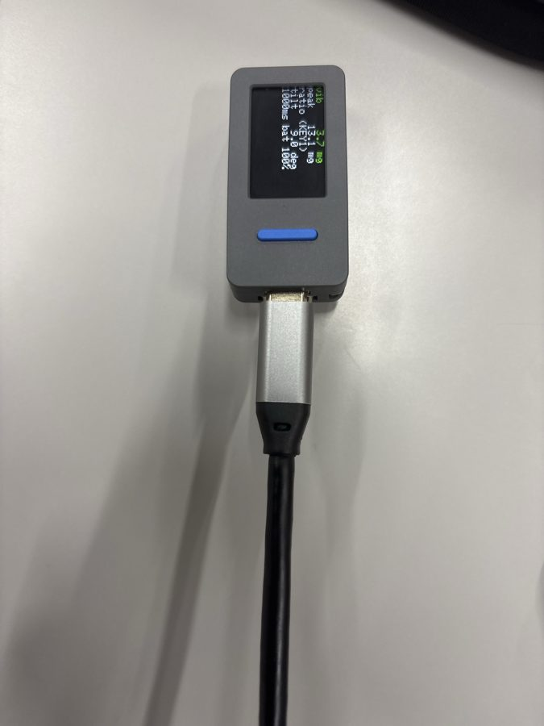
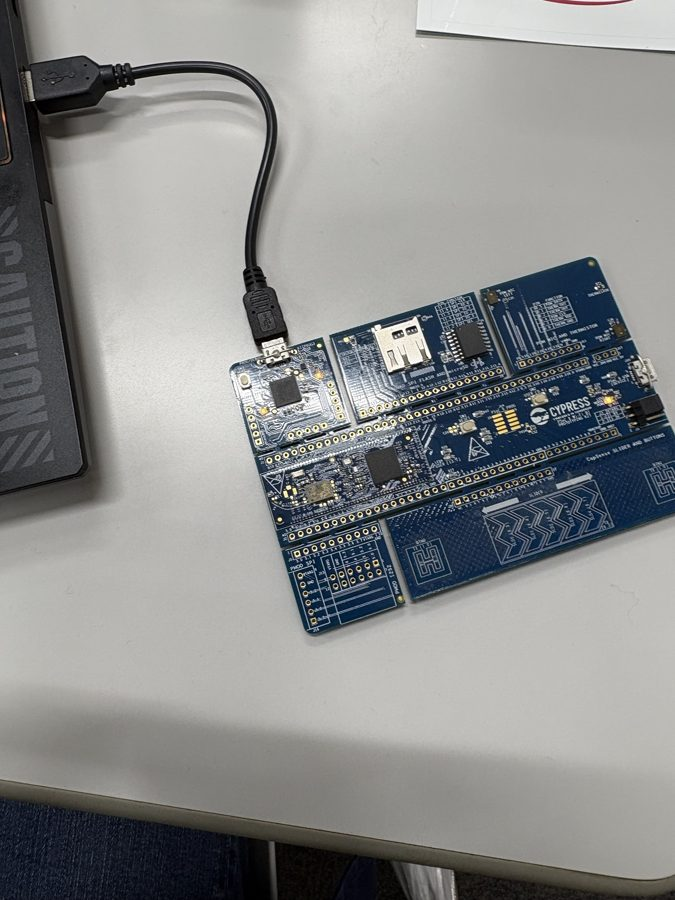

# ロボもり

[](https://docs.google.com/presentation/d/1iMbaZZ9icVo0Tvb6plEj2R-0JYNWx0dC/edit?usp=sharing)

不調なロボットにも、できる仕事を。

<div align="center">

[](https://skillicons.dev)

</div>

## 目次

- [動画リンク・公開資料](#動画リンク)
- [概要](#概要)
- [この公開リポジトリで確認できる範囲](#この公開リポジトリで確認できる範囲)
- [仕組み](#仕組み)
- [デモで確認できること](#デモで確認できること)
- [特長](#特長)
- [すぐに試す](#すぐに試す)
- [検証と限界](#検証と限界)
- [開発技術](#開発技術)
- [素材・ライセンス・構成](#素材とライセンス)


## 動画リンク

| 資料 | リンク |
|---|---|
| デモ動画 | [](https://www.youtube.com/watch?v=WcRn2Qti8B8) |
| 発表スライド（90秒ピッチ） | [](https://docs.google.com/presentation/d/1q2pgb6V9POOfRLsT5mzcMe8IJzqaaZ57/edit?usp=sharing&ouid=109700156691244901586&rtpof=true&sd=true) |
| 補足資料（背景・事業・市場と売上の見込み） | [](https://docs.google.com/presentation/d/1Fd_nJmBFcWzg-3xrGk1wrq9fqDtnbcEbSC7ygMG9M_Q/edit?usp=sharing) |
| 事業計画・詳細ドキュメント | [](docs/BUSINESS.md) |


## 概要

ロボもりは、ロボットが不調になったときに全部を止めるのではなく、危ない仕事だけを外して、できる仕事は続けてもらうための見守りの仕組みです。

ロボットの状態を仕事ごとの許可へ変換し、許されなくなった仕事だけを取り消します。運べる仕事は続け、外した仕事は別のロボットへ任せ直します。状態、任せている仕事、判断理由は人が確認できます。


| 状態 | 任せる仕事 | 動き |
|---|---|---|
| Normal（正常） | スープ・料理・空いた皿の回収 | 通常どおり |
| Warning（注意） | 料理・空いた皿の回収 | スープだけ別の機体へ |
| Limited（制限） | 空いた皿の回収 | 料理も別の機体へ |
| 停止中 | なし | 人が確認するまで移動しない |

## この公開リポジトリで確認できる範囲

このリポジトリには、審査とレビューに必要な Unity シミュレーター、自作素材、検証入口に加え、M5StickS3 の測定値を Unity へ渡す Python 中継と、PC 1 台で動く Robomori core（ダッシュボード・ルール AI・会社だけの共有）を収録しています。M5StickS3 のファームウェアと実ロボットは別構成です。

| 対象 | 収録状況 | 確認先 |
|---|---|---|
| 仕事ごとの能力判定と再割り当て | 収録 | [`GuardianCapabilityPolicy.cs`](Assets/Scripts/GuardianCapabilityPolicy.cs) / [`GuardianSimulator.cs`](Assets/Scripts/GuardianSimulator.cs) |
| 皿の所有権と物理的な引き継ぎ | 収録 | [`GuardianDishInventory.cs`](Assets/Scripts/GuardianDishInventory.cs) |
| 通路予約と障害物ブレーキ | 収録 | [`GuardianTrafficController.cs`](Assets/Scripts/GuardianTrafficController.cs) |
| 歩行者安全デモ | オプトインで収録 | [`GuardianPedestrianSafety.cs`](Assets/Scripts/GuardianPedestrianSafety.cs) |
| 日本語の定型操作デモ | オプトインで収録 | [`GuardianInteractionPanel.cs`](Assets/Scripts/GuardianInteractionPanel.cs) / [`GuardianRuleConversation.cs`](Assets/Scripts/GuardianRuleConversation.cs) |
| M5StickS3 と Python 中継 | 中継のみ収録（ファームウェアは非収録） | [`scripts/sensor_bridge/`](scripts/sensor_bridge/README.md) |
| ルール AI とダッシュボード | 収録 | [`core/guardian/rules.json`](core/guardian/rules.json) / [`core/README.md`](core/README.md) |
| 会社だけの共有（暗号化・AT プロトコル・仮想 VPN） | 収録（秘密の値は `.env` のみ） | [`scripts/guardian_share/seal.py`](scripts/guardian_share/seal.py) / [`core/viewer/`](core/viewer/index.html) |
| 実ロボット、権利未確認モデル | 非収録 | [公開範囲と制約](docs/PUBLIC_SCOPE.md) |

## 仕組み

[](docs/images/system-model.png)

図はセンサー連携と共有を含む全体構成です。M5StickS3 の揺れを Python 中継が Normal / Warning / Limited / Hold に変えて Unity へ送り、Robomori core はその記録と Unity の様子からルール AI（`rules.json` の数値だけで判断、API なし）で安全・注意・危険を判断します。外への共有は、人が PSoC 6 の SW2（扉 2）を押したときだけで、要約は会社と保守会社の鍵でしか開けない形に暗号化して、会社の PDS に置きます。M5StickS3 がなくても、模擬入力で能力制限、仕事の取り消し、再割り当て、皿の返却、停止と復帰を確認できます。

外部入力の Warning / Limited は能力制限として扱い、許可された仕事を止めません。Hold のときだけ対象機を止め、Normal に戻ったときは外部入力がかけた Hold だけを解除します。人が Unity で押した STOP は、外部入力から勝手に解除しません。

## デモで確認できること

Unity のレストランでは通常 3 台、予備機を含めると 5 台のロボットが、スープ、料理、空いた皿の回収を分担します。

| 場面 | シミュレーターで起きること |
|---|---|
| 担当機が Warning になる | 許されなくなったスープを外し、別の機体へ任せ直す |
| 担当機が Limited になる | 空いた皿の回収だけを残し、料理を別の機体へ任せ直す |
| 運搬中に仕事を外される | 皿を元の受け渡し場所へ戻してから、別の機体が引き継ぐ |
| 人が STOP を選ぶ | 状態の色とは別に停止し、人の操作でのみ再開する |
| 歩行者が進路を横切る | 能力・仕事・積載を変えず、危険がなくなるまで移動だけを止める |
| 日本語で停止を指示する | 対象と操作を確認待ちにし、別入力の「実行」で確定する |

歩行者と日本語操作は明示的に有効化する公開デモです。通常起動時の既存の配膳挙動を無断で変更しません。

## 特長

### 1. ロボットではなく、仕事ごとに任せるかを決める

状態と仕事の対応を 1 つの表に集約しています。状態が変わったときは許されなくなった仕事だけを取り消し、許されている仕事と移動能力は維持します。

実装: [`GuardianCapabilityPolicy.cs`](Assets/Scripts/GuardianCapabilityPolicy.cs) / [`GuardianSimulator.cs`](Assets/Scripts/GuardianSimulator.cs)

### 2. 運んでいる皿を見失わずに引き継ぐ

仕事、皿、ロボットに別々の ID を持たせ、皿の持ち主を厨房・ロボット・テーブル・回収台のいずれか 1 か所に決めます。運搬途中で担当を外れた機体は皿を元の受け渡し場所へ返し、所有権と予約を戻してから次の機体へ引き継ぎます。

実装: [`GuardianDishInventory.cs`](Assets/Scripts/GuardianDishInventory.cs) / [`GuardianSimulator.cs`](Assets/Scripts/GuardianSimulator.cs)

### 3. 歩行者による停止とロボットの状態を分ける

歩行者との接近は現在速度、停止距離、最接近距離から予測します。危険な間は移動出力だけをゼロにし、ロボットの能力状態、担当仕事、積載した皿は変更しません。通過後は同じ仕事を再開できます。

実装: [`GuardianPedestrianSafety.cs`](Assets/Scripts/GuardianPedestrianSafety.cs) / [歩行者検証](Assets/Editor/GuardianPedestrianBatch.cs)

### 4. 日本語の操作は確認してから反映する

定型文をローカルで解析し、対象と操作を確認待ちにします。「実行」が来るまで状態を変えず、対象の状態が変化した、確認が古い、入力が曖昧、歩行者安全停止中に復帰を求めた、という場合は拒否します。生成 AI、外部 API、録音音声は使いません。

実装: [`GuardianRuleConversation.cs`](Assets/Scripts/GuardianRuleConversation.cs) / [`GuardianInteractionPanel.cs`](Assets/Scripts/GuardianInteractionPanel.cs) / [入力検証](Assets/Editor/GuardianInteractionBatch.cs)

### 5. シーンを作り直すときも既存の作業を守る

Editor の生成ツールは別シーンを勝手に閉じず、再生成前に対象シーンをバックアップします。生成後は Simulator、ロボット ID、素材、通路クリアランスを検証してから保存し、Build Settings の既存項目を削除しません。

実装: [`GuardianSceneSetup.cs`](Assets/Editor/GuardianSceneSetup.cs) / [`GuardianSceneTools.cs`](Assets/Editor/GuardianSceneTools.cs) / [シーン検証](Assets/Editor/GuardianSceneBatch.cs)

## すぐに試す

### Unity シミュレーター

1. Unity Hub で Unity `6000.3.12f1` を用意し、このリポジトリのルートを開きます。
2. 初回インポートを待ちます。シーンがない場合は `Guardian > Scene Tools...` または `Guardian > Create or Rebuild 3D Simulator Scene` で公開素材から生成します。
3. `Assets/Scenes/GuardianRestaurant.unity` を開いて Play を押します。
4. 右側のパネルから状態、STOP、注文、予備機を操作します。詳しいキー操作は [セットアップ](docs/SETUP.md) にあります。

歩行者デモは Unity の起動引数 `-guardianPedestrianDemo`、日本語操作デモは `-guardianInteractionDemo` で有効化します。

### 統合検証

ライセンス済みの Unity Editor がある環境では、設定、能力表、歩行者予測、日本語入力、シーン生成を同じプロセスで確認できます。

Windows:

```powershell
scripts\Invoke-GuardianVerification.ps1
```

macOS / Linux:

```bash
scripts/verify-guardian-unity.sh
```

## 検証と限界

| 対象 | 検証入口 | 実装 |
|---|---|---|
| 設定ロードと不正値の拒否 | `GuardianSettingsBatch.Verify` | [`GuardianSettingsBatch.cs`](Assets/Editor/GuardianSettingsBatch.cs) |
| 歩行者の交差、平行移動、初期重なり | `GuardianPedestrianBatch.Verify` | [`GuardianPedestrianBatch.cs`](Assets/Editor/GuardianPedestrianBatch.cs) |
| 日本語入力、確認期限、状態競合 | `GuardianInteractionBatch.Verify` | [`GuardianInteractionBatch.cs`](Assets/Editor/GuardianInteractionBatch.cs) |
| シーン生成、バックアップ、Build Settings 保持 | `GuardianSceneBatch.Verify` | [`GuardianSceneBatch.cs`](Assets/Editor/GuardianSceneBatch.cs) |
| 上記の公開版統合 | `GuardianIntegrationBatch.Verify` | [`GuardianIntegrationBatch.cs`](Assets/Editor/GuardianIntegrationBatch.cs) |

GitHub Actions は、C# の境界、設定、素材、起動スクリプト、検証入口の接続を静的に確認します。クラウド CI では Unity Editor を起動しないため、チェック成功を Play Mode、描画、実クリック、実センサーの成功とは表現しません。

実機へ適用する場合は、機体、荷物、床、速度に合わせた校正と安全評価が必要です。

- シミュレーターは現場での安全性や効果を保証するものではありません。
- 歩行者デモの観測値は Unity 内の真値で、実カメラや実センサーの性能を再現しません。
- 実物センサーとの接続結果は、この公開版だけの Unity 実行結果と混同しません。

## 開発技術

### 活用した技術

| 技術 | ロボもりでの役割 |
|---|---|
|   | 3D 店内、仕事の割り当て、操作画面、Editor 検証。Rigidbody / BoxCast で移動・停止・障害物を扱い、IMGUI / TextMesh で状態と理由を表示します。 |
|   | 家具・料理・人物の 3D 素材を生成し、追加モデルなしで店内デモを再現します。 |
|   | 実機連携の計測端末。内蔵 ESP32-S3-PICO-1-N8R8 と BMI270 を M5Unified で扱い、振動を USB シリアルで Python 中継へ送ります。 |
|  | シミュレーター設定を、人が読んで確認できる形式で保存・読み込みします。 |
|   | 人の鍵（扉 2）。CY8CPROTO-062-4343W の SW2 を押したときだけ、記録を Google Drive へ送り、共有を始めます。 |
|   | センサー中継。M5StickS3 の測定値を Normal / Warning / Limited / Hold に変え、TCP で Unity へ送ります。 |
|   | Robomori core。PC 1 台で動くダッシュボード、ルール AI（`rules.json`）、ワンタイムパスワード、外へ出る道を絞る許可リスト。 |
|   | 会社ごとの障害記録の共有。独自 Lexicon（`internal.robomori.report`）の記録を、社内 VPN の PDS または bsky.social に置きます。 |
|  | 記録の暗号化（ECDH P-256 + HKDF-SHA256 + AES-256-GCM）。会社と保守会社の鍵でしか開けず、鍵はブラウザの外に出ません。 |
|  | 社内向けの記録の書き出し先。 |
|   | 実装の支援（コーディングエージェント）。設計と判断は人が行い、生成したコードはテストと人の確認を通してから取り込みます。製品の判断には使いません（ロボもりの判断はルール AI だけ）。 |
|  | Unity Editor がない環境でも、素材・コードの境界・検証入口を静的に確認します。 |

判断に外部 API や生成 AI は使いません。通常のデモはインターネット接続なしで動作します。外へ出るのは、人が扉 2（PSoC 6 の SW2）を開けたときの暗号化した要約だけで、送り先は社内 VPN の PDS（または bsky.social）に限ります。アカウントやパスワードはすべて `.env` に置き、リポジトリには含めません。

実機連携で使用するハードウェアは、揺れを測る M5StickS3 と、人が記録を外へ出すときに押すスイッチとして使う PSoC 6（CY8CPROTO-062-4343W）の 2 つです。PSoC 6 の SW2 を押したときだけ、記録を Google Drive へ送り、会社だけが開ける形に暗号化した要約を共有します。M5StickS3 のファームウェアは変更していません。連携構成と使用機能は [実機連携ガイド](docs/HARDWARE_ASSEMBLY.md) にまとめています。

#### 使用した機材

| M5StickS3（揺れを測る） | PSoC 6 CY8CPROTO-062-4343W（SW2 で Drive へ送信） |
|---|---|
|  |  |

### 独自技術

ロボもりの中心は、状態を仕事ごとの許可へ変換し、許されない仕事だけを、物を見失わずに任せ直すことです。

#### 仕事の表と、許されない仕事だけの取り消し

[`GuardianCapabilityPolicy.cs`](Assets/Scripts/GuardianCapabilityPolicy.cs) の許可表を唯一の判定元にし、状態変更時は現在の仕事を再評価します。許可がなくなった仕事だけを取り消すため、Warning や Limited を全停止と同一視しません。

#### 皿の持ち主を保ったままの引き継ぎ

[`GuardianDishInventory.cs`](Assets/Scripts/GuardianDishInventory.cs) は皿の持ち主と予約を管理します。仕事の担当だけを先に付け替えず、返却、所有権変更、予約解除、次の割り当てを順に行うことで、二重所有と瞬間移動を防ぎます。

#### 止まった理由を別々に保つ

歩行者による停止、手動 STOP、能力状態は別の理由として扱います。安全停止が解除されても能力状態と仕事は勝手に変わらず、能力状態が正常でも手動 STOP は残ります。この分離により、画面の色と実際の移動が食い違う原因を追跡できます。

## 素材とライセンス

- ソースコードは [MIT License](LICENSE) で公開しています。
- 家具、料理、人物はプロジェクト内で生成した素材です。生成方法は [`Assets/Art/Restaurant/`](Assets/Art/Restaurant/README.md) にあります。
- 日本語表示には Noto Sans JP を同梱し、[SIL Open Font License 1.1](Assets/Art/Fonts/Resources/NotoSansJP-OFL.txt) に従います。フォントは MIT へ変更しません。
- Nekobot は再配布条件を確認できていないため、元データ、モデル、テクスチャ、ビルドを収録していません。追加モデルなしで公開デモを生成できます。
- 外部写真を含む既存資料の出典は、画像内および関連文書に記載しています。

## リポジトリ構成

| パス | 内容 |
|---|---|
| [`Assets/Scripts/`](Assets/Scripts/) | Unity の実行コード |
| [`Assets/Editor/`](Assets/Editor/) | シーン生成と公開版の検証入口 |
| [`Assets/Art/Restaurant/`](Assets/Art/Restaurant/README.md) | 自作した店内・料理・人物素材 |
| [`.github/workflows/`](.github/workflows/) | 静的 CI |
| [`docs/`](docs/) | セットアップ、公開範囲、事業・審査資料 |
| [`core/`](core/README.md) | Robomori core（Docker：ダッシュボード、ルール AI、扉 2、会社だけの共有、仮想 VPN の PDS、一括デモ起動） |
| [`scripts/`](scripts/) | Unity 検証と任意素材のローカル取込、M5 のセンサー中継、共有 |

## 資料

- [発表スライド](https://docs.google.com/presentation/d/1iMbaZZ9icVo0Tvb6plEj2R-0JYNWx0dC/edit?usp=sharing)
- [背景・事業・市場の補足資料](https://docs.google.com/presentation/d/1Fd_nJmBFcWzg-3xrGk1wrq9fqDtnbcEbSC7ygMG9M_Q/edit?usp=sharing)
- [文章版の事業資料](docs/BUSINESS.md)
- [公開範囲と検証](docs/PUBLIC_SCOPE.md)
- [実機連携ガイド（M5StickS3）](docs/HARDWARE_ASSEMBLY.md)
- [使用センサーと測定上の注意](docs/REAL_SENSOR_OPTIONS.md)


