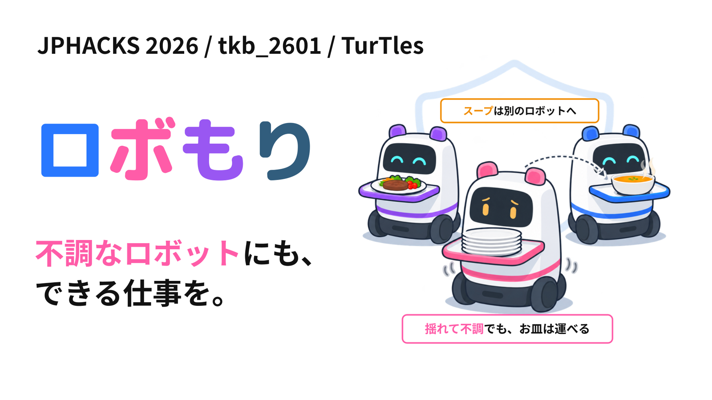
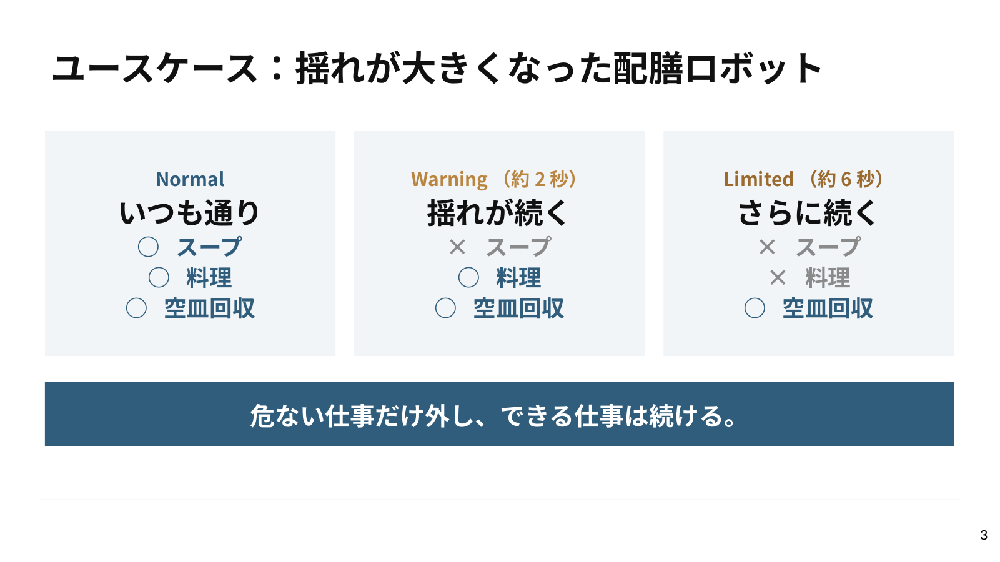
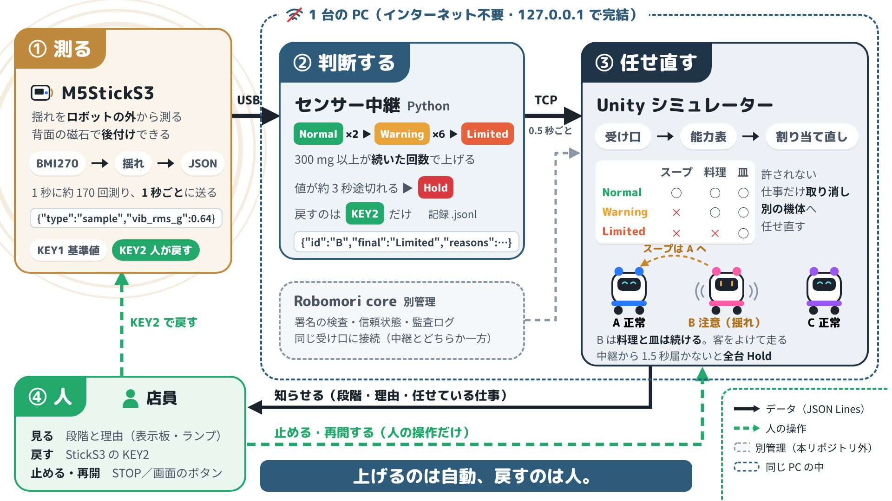
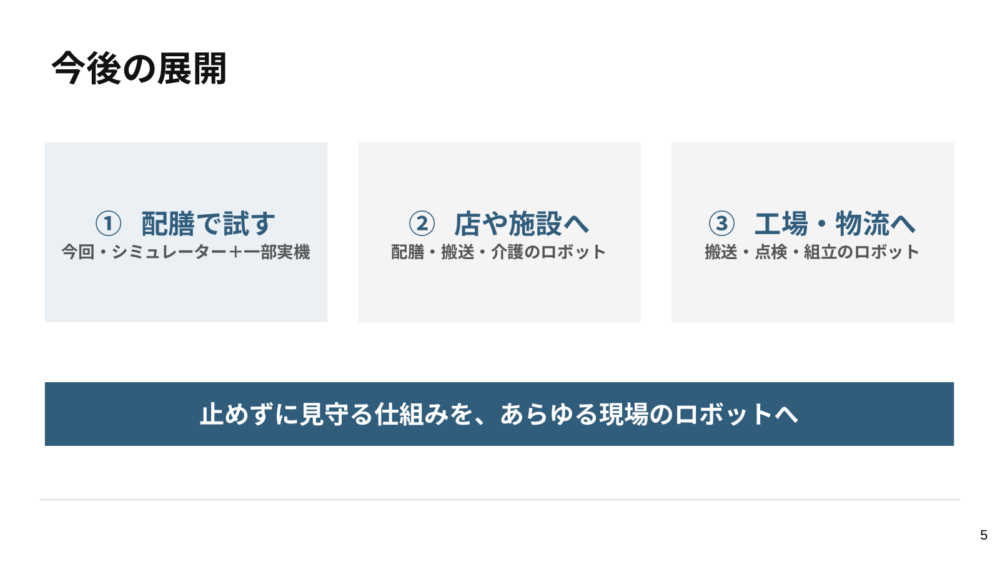

# ロボもり

[](https://docs.google.com/presentation/d/1iMbaZZ9icVo0Tvb6plEj2R-0JYNWx0dC/edit?usp=sharing)

不調なロボットにも、できる仕事を。

<div align="center">

[](https://skillicons.dev)

</div>

## 目次

- [動画リンク](#動画リンク)
- [概要](#概要)
- [この公開リポジトリで確認できる範囲](#この公開リポジトリで確認できる範囲)
- [仕組み](#仕組み)
- [デモで確認できること](#デモで確認できること)
- [特長](#特長)
- [すぐに試す](#すぐに試す)
- [検証と限界](#検証と限界)
- [開発技術](#開発技術)
- [素材・ライセンス・構成](#素材とライセンス)

## 動画リンク

- デモ動画：公開用のリンクは準備ができ次第追加します。
- 発表スライド（90 秒ピッチ）：[ロボもり｜90 秒ピッチ](https://docs.google.com/presentation/d/1iMbaZZ9icVo0Tvb6plEj2R-0JYNWx0dC/edit?usp=sharing)
- 補足資料（背景・事業・市場と売上の見込み）：[ロボもり｜補足資料](https://docs.google.com/presentation/d/1Fd_nJmBFcWzg-3xrGk1wrq9fqDtnbcEbSC7ygMG9M_Q/edit?usp=sharing)。文章でまとめたものは [docs/BUSINESS.md](docs/BUSINESS.md) にあります。

## 概要

ロボもりは、ロボットが不調になったときに全部を止めるのではなく、危ない仕事だけを外して、できる仕事は続けてもらうための見守りの仕組みです。

ロボットの状態を仕事ごとの許可へ変換し、許されなくなった仕事だけを取り消します。運べる仕事は続け、外した仕事は別のロボットへ任せ直します。状態、任せている仕事、判断理由は人が確認できます。



| 状態 | 任せる仕事 | 動き |
|---|---|---|
| Normal（正常） | スープ・料理・空いた皿の回収 | 通常どおり |
| Warning（注意） | 料理・空いた皿の回収 | スープだけ別の機体へ |
| Limited（制限） | 空いた皿の回収 | 料理も別の機体へ |
| 停止中 | なし | 人が確認するまで移動しない |

## この公開リポジトリで確認できる範囲

このリポジトリには、審査とレビューに必要な Unity シミュレーター、自作素材、検証入口を収録しています。M5StickS3 と Python 中継、実ロボットは別構成です。

| 対象 | 収録状況 | 確認先 |
|---|---|---|
| 仕事ごとの能力判定と再割り当て | 収録 | [`GuardianCapabilityPolicy.cs`](Assets/Scripts/GuardianCapabilityPolicy.cs) / [`GuardianSimulator.cs`](Assets/Scripts/GuardianSimulator.cs) |
| 皿の所有権と物理的な引き継ぎ | 収録 | [`GuardianDishInventory.cs`](Assets/Scripts/GuardianDishInventory.cs) |
| 通路予約と障害物ブレーキ | 収録 | [`GuardianTrafficController.cs`](Assets/Scripts/GuardianTrafficController.cs) |
| 歩行者安全デモ | オプトインで収録 | [`GuardianPedestrianSafety.cs`](Assets/Scripts/GuardianPedestrianSafety.cs) |
| 日本語の定型操作デモ | オプトインで収録 | [`GuardianInteractionPanel.cs`](Assets/Scripts/GuardianInteractionPanel.cs) / [`GuardianRuleConversation.cs`](Assets/Scripts/GuardianRuleConversation.cs) |
| M5StickS3 と Python 中継 | 非収録 | この公開リポジトリでは模擬入力を使用 |
| 実ロボット、権利未確認モデル | 非収録 | [公開範囲と制約](docs/PUBLIC_SCOPE.md) |

## 仕組み

[](docs/images/system-model.png)

図はセンサー連携を含む全体構成です。この公開リポジトリでは、模擬入力を使って能力制限、仕事の取り消し、再割り当て、皿の返却、停止と復帰を確認できます。実物の M5StickS3 から状態を送るファームウェアと Python 中継は含みません。

外部入力の Warning / Limited は能力制限として扱い、許可された仕事を止めません。Hold のときだけ対象機を止め、Normal に戻ったときは外部入力がかけた Hold だけを解除します。人が Unity で押した STOP は、外部入力から勝手に解除しません。

## デモで確認できること

Unity のレストランでは通常 3 台、予備機を含めると 5 台のロボットが、スープ、料理、空いた皿の回収を分担します。

| 場面 | シミュレーターで起きること |
|---|---|
| 担当機が Warning になる | 許されなくなったスープを外し、別の機体へ任せ直す |
| 担当機が Limited になる | 空いた皿の回収だけを残し、料理を別の機体へ任せ直す |
| 運搬中に仕事を外される | 皿を元の受け渡し場所へ戻してから、別の機体が引き継ぐ |
| 人が STOP を選ぶ | 状態の色とは別に停止し、人の操作でのみ再開する |
| 歩行者が進路を横切る | 能力・仕事・積載を変えず、危険がなくなるまで移動だけを止める |
| 日本語で停止を指示する | 対象と操作を確認待ちにし、別入力の「実行」で確定する |

歩行者と日本語操作は明示的に有効化する公開デモです。通常起動時の既存の配膳挙動を無断で変更しません。

## 特長

### 1. ロボットではなく、仕事ごとに任せるかを決める

状態と仕事の対応を 1 つの表に集約しています。状態が変わったときは許されなくなった仕事だけを取り消し、許されている仕事と移動能力は維持します。

実装: [`GuardianCapabilityPolicy.cs`](Assets/Scripts/GuardianCapabilityPolicy.cs) / [`GuardianSimulator.cs`](Assets/Scripts/GuardianSimulator.cs)

### 2. 運んでいる皿を見失わずに引き継ぐ

仕事、皿、ロボットに別々の ID を持たせ、皿の持ち主を厨房・ロボット・テーブル・回収台のいずれか 1 か所に決めます。運搬途中で担当を外れた機体は皿を元の受け渡し場所へ返し、所有権と予約を戻してから次の機体へ引き継ぎます。

実装: [`GuardianDishInventory.cs`](Assets/Scripts/GuardianDishInventory.cs) / [`GuardianSimulator.cs`](Assets/Scripts/GuardianSimulator.cs)

### 3. 歩行者による停止とロボットの状態を分ける

歩行者との接近は現在速度、停止距離、最接近距離から予測します。危険な間は移動出力だけをゼロにし、ロボットの能力状態、担当仕事、積載した皿は変更しません。通過後は同じ仕事を再開できます。

実装: [`GuardianPedestrianSafety.cs`](Assets/Scripts/GuardianPedestrianSafety.cs) / [歩行者検証](Assets/Editor/GuardianPedestrianBatch.cs)

### 4. 日本語の操作は確認してから反映する

定型文をローカルで解析し、対象と操作を確認待ちにします。「実行」が来るまで状態を変えず、対象の状態が変化した、確認が古い、入力が曖昧、歩行者安全停止中に復帰を求めた、という場合は拒否します。生成 AI、外部 API、録音音声は使いません。

実装: [`GuardianRuleConversation.cs`](Assets/Scripts/GuardianRuleConversation.cs) / [`GuardianInteractionPanel.cs`](Assets/Scripts/GuardianInteractionPanel.cs) / [入力検証](Assets/Editor/GuardianInteractionBatch.cs)

### 5. シーンを作り直すときも既存の作業を守る

Editor の生成ツールは別シーンを勝手に閉じず、再生成前に対象シーンをバックアップします。生成後は Simulator、ロボット ID、素材、通路クリアランスを検証してから保存し、Build Settings の既存項目を削除しません。

実装: [`GuardianSceneSetup.cs`](Assets/Editor/GuardianSceneSetup.cs) / [`GuardianSceneTools.cs`](Assets/Editor/GuardianSceneTools.cs) / [シーン検証](Assets/Editor/GuardianSceneBatch.cs)

## すぐに試す

### Unity シミュレーター

1. Unity Hub で Unity `6000.3.12f1` を用意し、このリポジトリのルートを開きます。
2. 初回インポートを待ちます。シーンがない場合は `Guardian > Scene Tools...` または `Guardian > Create or Rebuild 3D Simulator Scene` で公開素材から生成します。
3. `Assets/Scenes/GuardianRestaurant.unity` を開いて Play を押します。
4. 右側のパネルから状態、STOP、注文、予備機を操作します。詳しいキー操作は [セットアップ](docs/SETUP.md) にあります。

歩行者デモは Unity の起動引数 `-guardianPedestrianDemo`、日本語操作デモは `-guardianInteractionDemo` で有効化します。

### 統合検証

ライセンス済みの Unity Editor がある環境では、設定、能力表、歩行者予測、日本語入力、シーン生成を同じプロセスで確認できます。

Windows:

```powershell
scripts\Invoke-GuardianVerification.ps1
```

macOS / Linux:

```bash
scripts/verify-guardian-unity.sh
```

## 検証と限界

| 対象 | 検証入口 | 実装 |
|---|---|---|
| 設定ロードと不正値の拒否 | `GuardianSettingsBatch.Verify` | [`GuardianSettingsBatch.cs`](Assets/Editor/GuardianSettingsBatch.cs) |
| 歩行者の交差、平行移動、初期重なり | `GuardianPedestrianBatch.Verify` | [`GuardianPedestrianBatch.cs`](Assets/Editor/GuardianPedestrianBatch.cs) |
| 日本語入力、確認期限、状態競合 | `GuardianInteractionBatch.Verify` | [`GuardianInteractionBatch.cs`](Assets/Editor/GuardianInteractionBatch.cs) |
| シーン生成、バックアップ、Build Settings 保持 | `GuardianSceneBatch.Verify` | [`GuardianSceneBatch.cs`](Assets/Editor/GuardianSceneBatch.cs) |
| 上記の公開版統合 | `GuardianIntegrationBatch.Verify` | [`GuardianIntegrationBatch.cs`](Assets/Editor/GuardianIntegrationBatch.cs) |

GitHub Actions は、C# の境界、設定、素材、起動スクリプト、検証入口の接続を静的に確認します。クラウド CI では Unity Editor を起動しないため、チェック成功を Play Mode、描画、実クリック、実センサーの成功とは表現しません。

実機へ適用する場合は、機体、荷物、床、速度に合わせた校正と安全評価が必要です。

- シミュレーターは現場での安全性や効果を保証するものではありません。
- 歩行者デモの観測値は Unity 内の真値で、実カメラや実センサーの性能を再現しません。
- 実物センサーとの接続結果は、この公開版だけの Unity 実行結果と混同しません。

## 開発技術

| 技術 | 役割 | 採用理由 |
|---|---|---|
| Unity / C# | 3D 店内、物理移動、割り当て、表示、Editor 検証 | ロボット、皿、人、通路の状態を同じ時間軸で確認できる |
| Rigidbody / BoxCast | ロボット移動、停止、障害物検出 | 表示上の移動ではなく物理位置で検証できる |
| IMGUI / TextMesh | 操作パネル、理由、状態表示 | 外部 UI パッケージなしで Editor と Player に表示できる |
| Blender / Python | 家具、料理、人物の 3D 素材生成 | 権利を確認できる自作素材で公開版を再現できる |
| JSON | シミュレーター設定 | 人がレビューでき、Unity 標準機能で読み込める |
| GitHub Actions | 素材、境界、検証入口の静的確認 | Unity Editor がない環境でも必要なファイルの欠落と意図しない混入を検出できる |

外部 API とクラウドは使用しません。通常のデモはインターネット接続なしで動作します。

### 独自技術

ロボもりの中心は、状態を仕事ごとの許可へ変換し、許されない仕事だけを、物を見失わずに任せ直すことです。

#### 仕事の表と、許されない仕事だけの取り消し

[`GuardianCapabilityPolicy.cs`](Assets/Scripts/GuardianCapabilityPolicy.cs) の許可表を唯一の判定元にし、状態変更時は現在の仕事を再評価します。許可がなくなった仕事だけを取り消すため、Warning や Limited を全停止と同一視しません。

#### 皿の持ち主を保ったままの引き継ぎ

[`GuardianDishInventory.cs`](Assets/Scripts/GuardianDishInventory.cs) は皿の持ち主と予約を管理します。仕事の担当だけを先に付け替えず、返却、所有権変更、予約解除、次の割り当てを順に行うことで、二重所有と瞬間移動を防ぎます。

#### 止まった理由を別々に保つ

歩行者による停止、手動 STOP、能力状態は別の理由として扱います。安全停止が解除されても能力状態と仕事は勝手に変わらず、能力状態が正常でも手動 STOP は残ります。この分離により、画面の色と実際の移動が食い違う原因を追跡できます。

## 素材とライセンス

- ソースコードは [MIT License](LICENSE) で公開しています。
- 家具、料理、人物はプロジェクト内で生成した素材です。生成方法は [`Assets/Art/Restaurant/`](Assets/Art/Restaurant/README.md) にあります。
- 日本語表示には Noto Sans JP を同梱し、[SIL Open Font License 1.1](Assets/Art/Fonts/Resources/NotoSansJP-OFL.txt) に従います。フォントは MIT へ変更しません。
- Nekobot は再配布条件を確認できていないため、元データ、モデル、テクスチャ、ビルドを収録していません。追加モデルなしで公開デモを生成できます。
- 外部写真を含む既存資料の出典は、画像内および関連文書に記載しています。

## リポジトリ構成

| パス | 内容 |
|---|---|
| [`Assets/Scripts/`](Assets/Scripts/) | Unity の実行コード |
| [`Assets/Editor/`](Assets/Editor/) | シーン生成と公開版の検証入口 |
| [`Assets/Art/Restaurant/`](Assets/Art/Restaurant/README.md) | 自作した店内・料理・人物素材 |
| [`.github/workflows/`](.github/workflows/) | 静的 CI |
| [`docs/`](docs/) | セットアップ、公開範囲、事業・審査資料 |
| [`scripts/`](scripts/) | Unity 検証と任意素材のローカル取込 |

## 資料

- [発表スライド](https://docs.google.com/presentation/d/1iMbaZZ9icVo0Tvb6plEj2R-0JYNWx0dC/edit?usp=sharing)
- [背景・事業・市場の補足資料](https://docs.google.com/presentation/d/1Fd_nJmBFcWzg-3xrGk1wrq9fqDtnbcEbSC7ygMG9M_Q/edit?usp=sharing)
- [文章版の事業資料](docs/BUSINESS.md)
- [公開範囲と検証](docs/PUBLIC_SCOPE.md)
- [実機の組み立てガイド](docs/HARDWARE_ASSEMBLY.md)
- [センサー候補と測定上の注意](docs/REAL_SENSOR_OPTIONS.md)


