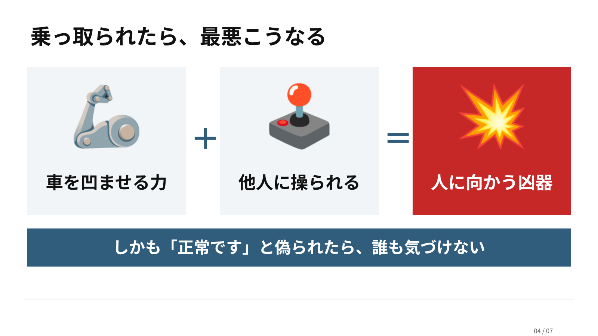
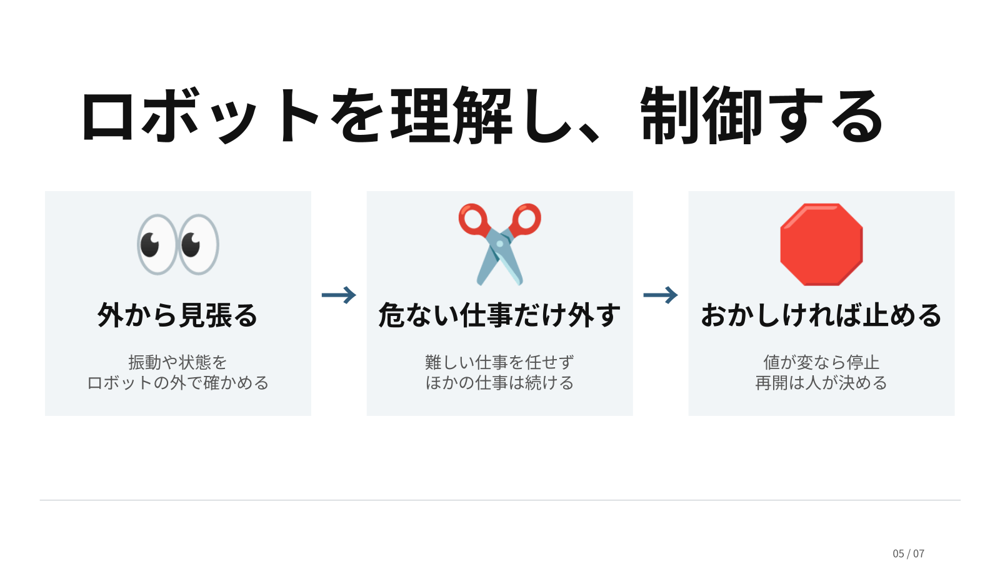
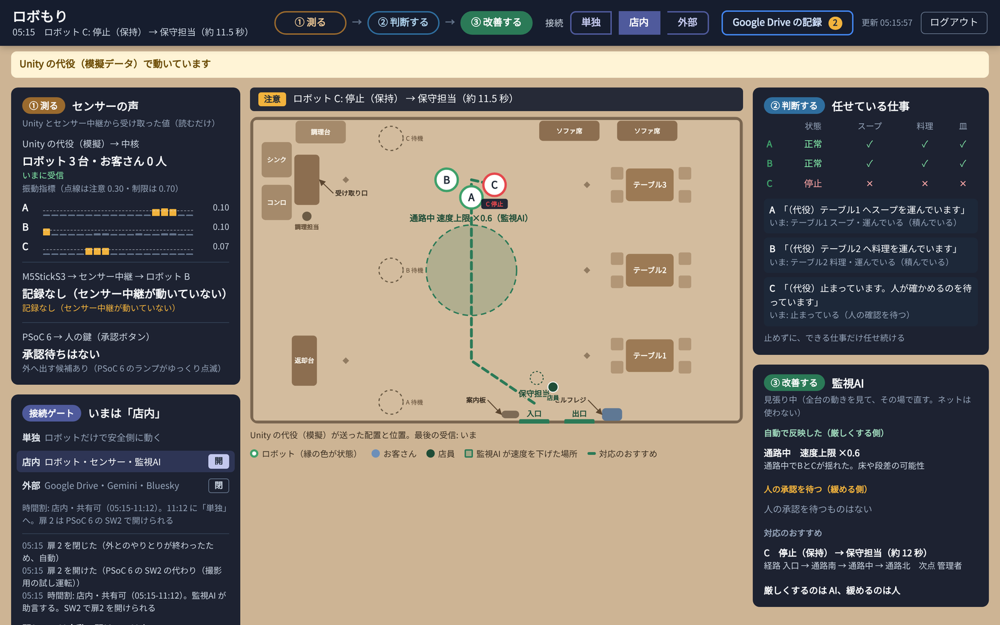
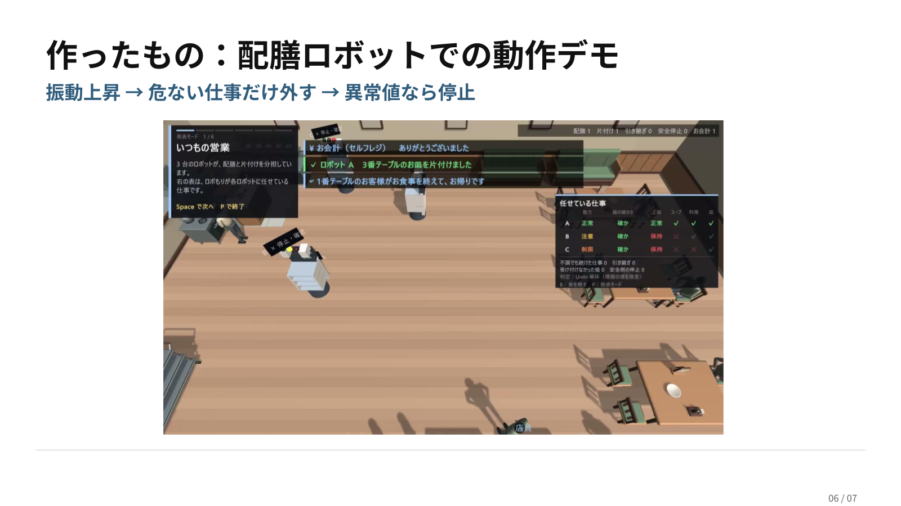

# ロボもり

[](https://docs.google.com/presentation/d/1q2pgb6V9POOfRLsT5mzcMe8IJzqaaZ57/edit?usp=sharing&ouid=109700156691244901586&rtpof=true&sd=true)

<div align="center">

**不調なロボットにも、できる仕事を。**

チーム **TurTles**

[](https://skillicons.dev)

</div>

<div align="center">

## 🎉 JPHACKS 2026 受賞結果 🎉

### 🏆 Hack Day（東京B会場）

[](https://www.infineon.com/)

</div>

## 目次

- [動画リンク・公開資料](#動画リンク)
- [概要](#概要)
- [開発の動機](#開発の動機作者より)
- [ペルソナ](#ペルソナ)
- [課題](#課題)
- [本アプローチ](#本アプローチ)
- [この公開リポジトリで確認できる範囲](#この公開リポジトリで確認できる範囲)
- [特長](#特長)
- [用語集](#用語集)
- [技術](#技術)
- [デモで確認できること](#デモで確認できること)
- [すぐに試す](#すぐに試す)
- [検証と限界](#検証と限界)
- [関連研究](#関連研究)
- [Award Day に向けて](#award-day-に向けて)
- [今後の展望](#今後の展望)
- [素材・ライセンス・構成](#素材とライセンス)
- [謝辞](#謝辞)

## 動画リンク

| 資料 | リンク |
|---|---|
| デモ動画 | [](https://www.youtube.com/watch?v=WcRn2Qti8B8) |
| 発表スライド（90秒ピッチ） | [](https://docs.google.com/presentation/d/1q2pgb6V9POOfRLsT5mzcMe8IJzqaaZ57/edit?usp=sharing&ouid=109700156691244901586&rtpof=true&sd=true) |
| 補足資料（背景・事業・市場と売上の見込み） | [](https://docs.google.com/presentation/d/1Fd_nJmBFcWzg-3xrGk1wrq9fqDtnbcEbSC7ygMG9M_Q/edit?usp=sharing) |
| 事業計画・詳細ドキュメント | [](docs/BUSINESS.md) |

## 概要

ロボもりは、ロボットが不調になったときに全部を止めるのではなく、危ない仕事だけを外して、できる仕事は続けてもらうための見守りの仕組みです。

今回の提出で示すのは、この運用の流れ（状態の判定、仕事の制限と再割り当て、皿の引き継ぎ、停止と人による再開、記録の共有）を、Unity のシミュレーターと実物のセンサーでつないだ試作です。実機のロボットでの安全の限界、メーカーの運行管理との接続、店舗での効果、攻撃そのものの検知は、これからの検証の対象です。

<table role="table">
<thead>
<tr>
<th width="160" nowrap>項目</th>
<th>説明</th>
</tr>
</thead>
<tbody>
<tr>
<td width="160" nowrap><strong>誰のため</strong></td>
<td>配膳ロボットといっしょに働く飲食店のホール責任者と、そのロボットを受け持つ保守会社の担当者</td>
</tr>
<tr>
<td width="160" nowrap><strong>何に困っているか</strong></td>
<td>ロボットが不調になると「全部止める」か「そのまま動かす」しかない。つながったロボットが乗っ取られても、店では気づけない</td>
</tr>
<tr>
<td width="160" nowrap><strong>ロボもりの答え</strong></td>
<td>ロボットの外から揺れを測り、危ない仕事だけを外して、できる仕事は続けてもらう。制限を強める判断はシステムが自動で行い、通常運転に戻す判断、共有先と方式、書き出しの時間割は人が決める</td>
</tr>
<tr>
<td width="160" nowrap><strong>どう作ったか</strong></td>
<td>揺れを M5StickS3 で測り、Python のセンサー中継が状態を判定し、Unity のシミュレーターで仕事を再割り当てする。店全体の状況は、PC 上の Robomori core（Docker）のルール AI が評価する。AT プロトコルへの共有は人のボタン操作で開始し、既定の「会社だけ」では宛先の公開鍵で暗号化する。Drive には時間割でも平文を書き出す</td>
</tr>
</tbody>
</table>

### 状態ごとに任せる仕事

<table role="table">
<thead>
<tr>
<th width="160" nowrap>状態</th>
<th width="210">任せる仕事</th>
<th>動き</th>
</tr>
</thead>
<tbody>
<tr>
<td width="160" nowrap>Normal（正常）</td>
<td width="210">スープ・料理・空いた皿の回収</td>
<td>通常どおり</td>
</tr>
<tr>
<td width="160" nowrap>Warning（注意）</td>
<td width="210">料理・空いた皿の回収</td>
<td>スープだけ別の機体へ</td>
</tr>
<tr>
<td width="160" nowrap>Limited（制限）</td>
<td width="210">許可の表では空いた皿の回収だけ</td>
<td>センサー入力のときは安全側に倒して停止し、人の KEY2 を待つ<br>（手動の切り替えでは皿の回収を続ける）</td>
</tr>
<tr>
<td width="160" nowrap>Hold（停止）</td>
<td width="210">なし</td>
<td>センサーの値が途切れたときなど。人が確認するまで移動しない</td>
</tr>
</tbody>
</table>

## 開発の動機（作者より）

[@Taiga-Sekida](https://github.com/Taiga-Sekida) より

昨今、生成 AI を使ったセキュリティ攻撃が話題になっている。その多くは Web につながったアプリケーションが標的で、インターネットにつなぐこと自体がセキュリティホールを生む時代になっていると考えている。今後、AI が人を狙う形で、セキュリティの問題はさらに加速するだろう。

一方で、ロボティクスは目覚ましい進歩を遂げている。Unitree Robotics が公開した H2-X の[デモ動画](https://www.youtube.com/watch?v=Y3zb4o47yqA)を見ると、フィジカル AI の動きは、すでに一流のアスリートのような能力を秘めているように感じる。それは何を示すか。乗っ取られたときの被害が甚大になる、ということだ。

ロボットは、インターネット以上に凶器になる。自動運転の車が乗っ取られれば事故を起こし、多重事故にもつながる。同じように、これから工場や学校などさまざまな場所に広がるフィジカル AI が攻撃を受けて被害を生んだとき、責任を負うのが購入者になることは想像に難くない。

これを防ぐため、私たちは、ロボットの状態をセンサーで捉えて言葉にする仕組みを、外付けのハードとして開発することにした。ロボットに後付けできるデバイスとして広めることで、たとえば海外製のロボットがプロンプトインジェクションなどで操られ、意図しない動きをするおそれがあるときにも、外から停止命令を出せるようにすることを目指している。

## ペルソナ

公開資料と、デモの舞台にした配膳の現場から組み立てた、想定のペルソナです。

### 主なペルソナ：配膳ロボットと働くファミレスのホール責任者

<table role="table">
<thead>
<tr>
<th width="160" nowrap>項目</th>
<th>内容</th>
</tr>
</thead>
<tbody>
<tr>
<td width="160" nowrap>立場</td>
<td>ファミリーレストランのホール責任者。ピークの時間は、配膳ロボット 3 台と数人のホールスタッフで店内を回す</td>
</tr>
<tr>
<td width="160" nowrap>ロボットとの関係</td>
<td>ロボットは毎日いっしょに働く仲間。けれど中身には詳しくない。異常が出たら、止めて保守会社に連絡するしかない</td>
</tr>
<tr>
<td width="160" nowrap>困る場面</td>
<td>昼のピークに、1 台が床の段差でガタガタ揺れ始める。止めればその分を人が運ぶことになり、店が回らない。続ければスープをこぼすかもしれない</td>
</tr>
<tr>
<td width="160" nowrap>不安なこと</td>
<td>ロボットはお客さんのすぐ横を走る。ネットにつながったロボットが乗っ取られたり、「正常です」と偽られたりしても、店では気づけない</td>
</tr>
<tr>
<td width="160" nowrap>ほしいもの</td>
<td>止めるか続けるかの二択ではなく、「このロボットに今任せてよい仕事」が分かり、残りは自動で回ること。戻す判断は自分で持ちたい。記録は保守会社にだけ渡したい</td>
</tr>
</tbody>
</table>

### もう一人のペルソナ：店のロボットを受け持つ保守会社の担当者

<table role="table">
<thead>
<tr>
<th width="160" nowrap>項目</th>
<th>内容</th>
</tr>
</thead>
<tbody>
<tr>
<td width="160" nowrap>立場</td>
<td>いくつもの会社のお店のロボットの点検と修理を受け持つ</td>
</tr>
<tr>
<td width="160" nowrap>困る場面</td>
<td>どの会社のロボットが、いつ、何度止まったか、どれだけ揺れたかが、電話で聞くまで分からない。障害の多い会社に修理や買い替えを提案したくても、根拠がない</td>
</tr>
<tr>
<td width="160" nowrap>守るべきこと</td>
<td>記録はその会社のもの。公開の場には置けず、ほかの会社の記録と混ざってもいけない</td>
</tr>
<tr>
<td width="160" nowrap>ほしいもの</td>
<td>会社が見せると決めた記録だけを自分の鍵で開き、会社ごとに数えられること</td>
</tr>
</tbody>
</table>

### この先のユーザー：工場と物流の現場

同じ構図は、工場や物流の現場にもあります。買う判断をするのは製造の責任者、日々使うのは現場の担当者と設備保全の担当者です。配膳は、その最初の試し場所です（[docs/BUSINESS.md](docs/BUSINESS.md)）。

## 課題

ペルソナの困りごとを、仕組みの問題として言い直すと次の 4 つです。

1. **不調になると、全部止める。** 今のロボットは、異常を見つけると安全のために全部を止める作りが多くあります。揺れが大きくなった配膳ロボットでも、空いた皿の回収ならできるのに、その能力まで失います。かといってそのまま続ければ、状態に合わない仕事を任せ続けます。
2. **判断が現場の人に残る。** どの仕事を外し、誰に回すかを決めるのは、結局その場の人です。ロボットに詳しくない人には、何が起きて、なぜそうなったのかが見えません。
3. **つながるロボットは、攻撃の入口になる。** ネット越しの指示でロボットが動くなら、お客さんの横を走る機械を他人が操れることになります。しかも「正常です」と偽られたら、誰も気づけません。
4. **記録を外部に出せない。** 保守会社に見せたい記録ほど、店や会社の外に出すのが不安です。公開の場に置けば、誰でも読めてしまいます。



### 今取り組む理由

- AI セーフティ・インスティテュートの「AI ロボティクスに関するセーフティ評価観点ガイド」は、事例の一つに飲食店の搬送ロボットを挙げています。ロボットが代わりの行動を選んだときは、選んだ基準と結果をログに残し、後から確かめられることを求めています。
- 製造業は 5 年続けて、最も多く攻撃を受けた業種です（全体の 27.7%）。EU の機械規則は、安全に関わるソフトと設定を改ざんから守ることを求めています。
- 製造業で働く人は減り続け、人手が足りない現場が増えています。計画外の停止で、世界の大企業 500 社は売上の約 11% を失っています。

数字と出典は [docs/BUSINESS.md](docs/BUSINESS.md) にまとめています。

## 本アプローチ

ロボもりは、不調のロボットを「動かし続ける」か「止める」かの二択で判断するのではなく、「そのロボットに、今どの仕事なら任せられるか」で判断します。



<table role="table">
<thead>
<tr>
<th width="200" nowrap>困りごと</th>
<th>ロボもりの提案</th>
</tr>
</thead>
<tbody>
<tr>
<td width="200" nowrap>不調になると、<br>全部止める</td>
<td><strong>仕事ごとに任せるかを決める。</strong> 状態を「任せてよい仕事」の表に置き換え、許されなくなった仕事だけを外して、別のロボットに再割り当てする。できる仕事は止めずに続ける</td>
</tr>
<tr>
<td width="200" nowrap>判断が現場の<br>人に残る</td>
<td><strong>理由まで見せて、人の問いに答える。</strong> 状態、任せている仕事、変わった理由を同じ画面に出す。「いま危ない？」「B は？」には、ルール AI が数字の根拠を付けて答える</td>
</tr>
<tr>
<td width="200" nowrap>つながるロボットは<br>攻撃の入口</td>
<td><strong>ロボットの外から測り、ネットワークからの操作を絞る。</strong> ロボットの自己申告ではなく、後付けのセンサーで外から測る。ネットワーク経由で届く指示のうち、受け付けるのは「速度を下げる」指示だけにする。おかしな指示が続けば、ロボットとの通信を自動で切る（扉 1）</td>
</tr>
<tr>
<td width="200" nowrap>記録を外部に<br>出せない</td>
<td><strong>共有先と方式は人が選ぶ。</strong> AT プロトコルの既定の「会社だけ（暗号化）」では、人が共有を開始し、登録した宛先の秘密鍵でだけ開ける記録を保存する。公開モードも選べる。Drive の平文書き出しは、ボタン操作に加え、人が設定した時間割でも動く</td>
</tr>
</tbody>
</table>

設計の原則は、制限を強める判断はシステムが自動で行い、制限を解いて通常運転に戻す判断、共有先と方式、書き出しの時間割は人が決めることです。AT プロトコルへの共有は人の操作で開始し、Drive への書き出しは設定した時間割でも動きます。


### 導入前と導入後の比較（ホール責任者の 1 日）

| 場面 | これまで | ロボもりがあると |
|---|---|---|
| 昼のピークに、センサーを付けたロボット B が揺れ始める | 異常として B が止まり、B の分を人が運ぶ | B は Warning になる。スープだけが別のロボットに再割り当てされ、B は料理と皿の回収を続ける |
| 揺れがおさまらない | 止めたままになり、原因も分からない | B は Limited になり、センサー入力のときは安全側に倒して停止する。B の仕事はほかのロボットに再割り当てされ、人が点検して KEY2 で再開する |
| 何が起きているか知りたい | 保守会社に電話して説明する | ダッシュボードで B の状態と、その理由を確認できる。「B は？」と聞くと、ルール AI が根拠の数字を付けて答える |
| 同じ場所で何台も揺れる | 気づけない | 監視 AI が床の段差など場所の問題と判断し、その場所を通るときだけ速度を下げる |
| 直ったので戻したい | 再起動して様子を見る | 人が M5StickS3 のボタン（KEY2）を押して通常運転に戻す。自動では戻らない |
| 閉店後、記録を保守会社へ | 口頭やメールで伝える | 既定の「会社だけ」と宛先を設定して共有ボタン（PSoC 6 の SW2）を押すと、暗号化した要約が PDS に置かれる。登録した保守会社は自分の鍵で復号し、会社ごとの障害の件数を集計できる |

## この公開リポジトリで確認できる範囲

このリポジトリには、審査とレビューに必要な Unity シミュレーター、自作素材、検証入口に加え、M5StickS3 の測定値を Unity へ渡す Python 中継と Unity の受信側、M5StickS3 と PSoC 6 のファームウェア、PC 1 台で動く Robomori core（ダッシュボード・ルール AI・会社だけの共有）を収録しています。実ロボットは別構成です。

<table role="table">
<tr>
<th width="230" nowrap>対象</th>
<th>収録状況</th>
<th>確認先</th>
</tr>
<tr>
<td width="230" nowrap>仕事ごとの能力判定と<br>再割り当て</td>
<td>収録</td>
<td><a href="Assets/Scripts/GuardianCapabilityPolicy.cs"><code>GuardianCapabilityPolicy.cs</code></a> / <a href="Assets/Scripts/GuardianSimulator.cs"><code>GuardianSimulator.cs</code></a></td>
</tr>
<tr>
<td width="230" nowrap>皿の所有権と<br>物理的な引き継ぎ</td>
<td>収録</td>
<td><a href="Assets/Scripts/GuardianDishInventory.cs"><code>GuardianDishInventory.cs</code></a></td>
</tr>
<tr>
<td width="230" nowrap>通路予約と障害物ブレーキ</td>
<td>収録</td>
<td><a href="Assets/Scripts/GuardianTrafficController.cs"><code>GuardianTrafficController.cs</code></a></td>
</tr>
<tr>
<td width="230" nowrap>歩行者安全デモ</td>
<td>オプトインで収録</td>
<td><a href="Assets/Scripts/GuardianLegacyPedestrianSafety.cs"><code>GuardianLegacyPedestrianSafety.cs</code></a></td>
</tr>
<tr>
<td width="230" nowrap>日本語の定型操作デモ</td>
<td>オプトインで収録</td>
<td><a href="Assets/Scripts/GuardianInteractionPanel.cs"><code>GuardianInteractionPanel.cs</code></a> / <a href="Assets/Scripts/GuardianLegacyRuleConversation.cs"><code>GuardianLegacyRuleConversation.cs</code></a></td>
</tr>
<tr>
<td width="230" nowrap>M5StickS3・Python 中継・<br>Unity の受信側</td>
<td>収録</td>
<td><a href="docs/STICKS3_UNITY_LINK.md">接続手順と通信仕様</a> / <a href="firmware/sticks3_check/README.md"><code>firmware/sticks3_check/</code></a></td>
</tr>
<tr>
<td width="230" nowrap>PSoC 6 のボタン・ランプ</td>
<td>ファームウェアを収録</td>
<td><a href="firmware/psoc6_share_panel/README.md"><code>firmware/psoc6_share_panel/</code></a></td>
</tr>
<tr>
<td width="230" nowrap>ルール AI とダッシュボード</td>
<td>収録</td>
<td><a href="core/guardian/rules.json"><code>core/guardian/rules.json</code></a> / <a href="core/README.md"><code>core/README.md</code></a></td>
</tr>
<tr>
<td width="230" nowrap>監視 AI と扉 1・扉 2</td>
<td>収録</td>
<td><a href="scripts/guardian_hub/README.md"><code>scripts/guardian_hub/</code></a></td>
</tr>
<tr>
<td width="230" nowrap>会社だけの共有<br>（暗号化・AT プロトコル・<br>仮想 VPN）</td>
<td>収録（接続設定は <code>.env</code>、秘密鍵はローカル管理）</td>
<td><a href="scripts/guardian_share/seal.py"><code>scripts/guardian_share/seal.py</code></a> / <a href="core/viewer/index.html"><code>core/viewer/</code></a></td>
</tr>
<tr>
<td width="230" nowrap>実ロボット、権利未確認モデル</td>
<td>非収録</td>
<td><a href="docs/PUBLIC_SCOPE.md">公開範囲と制約</a></td>
</tr>
</table>

## 特長

### 1. ロボットではなく、仕事ごとに任せるかを決める

状態と仕事の対応を 1 つの表に集約しています。状態が変わったときは許されなくなった仕事だけを取り消し、許されている仕事と移動能力は維持します。

実装: [`GuardianCapabilityPolicy.cs`](Assets/Scripts/GuardianCapabilityPolicy.cs) / [`GuardianSimulator.cs`](Assets/Scripts/GuardianSimulator.cs)

### 2. 運んでいる皿を見失わずに引き継ぐ

仕事、皿、ロボットに別々の ID を持たせ、皿の持ち主を厨房・ロボット・テーブル・回収台のいずれか 1 か所に決めます。運搬途中で担当を外れた機体は皿を元の受け渡し場所へ返し、所有権と予約を戻してから次の機体へ引き継ぎます。

実装: [`GuardianDishInventory.cs`](Assets/Scripts/GuardianDishInventory.cs) / [`GuardianSimulator.cs`](Assets/Scripts/GuardianSimulator.cs)

### 3. 歩行者による停止とロボットの状態を分ける

`-guardianPedestrianDemo` で有効にする従来の公開デモでは、歩行者との接近を現在速度、停止距離、最接近距離から予測します。危険な間は移動出力だけをゼロにし、ロボットの能力状態、担当仕事、積載した皿は変更しません。通過後は同じ仕事を再開できます。

実装: [`GuardianLegacyPedestrianSafety.cs`](Assets/Scripts/GuardianLegacyPedestrianSafety.cs) / [歩行者検証](Assets/Editor/GuardianPedestrianBatch.cs)

### 4. 日本語の操作は確認してから反映する

`-guardianInteractionDemo` で有効にする従来の公開デモでは、定型文をローカルで解析し、対象と操作を確認待ちにします。「実行」が来るまで状態を変えず、対象の状態が変化した、確認が古い、入力が曖昧、歩行者安全停止中に復帰を求めた、という場合は拒否します。生成 AI、外部 API、録音音声は使いません。

実装: [`GuardianLegacyRuleConversation.cs`](Assets/Scripts/GuardianLegacyRuleConversation.cs) / [`GuardianInteractionPanel.cs`](Assets/Scripts/GuardianInteractionPanel.cs) / [入力検証](Assets/Editor/GuardianInteractionBatch.cs)

### 5. シーンを作り直すときも既存の作業を守る

Editor の生成ツールは別シーンを勝手に閉じず、再生成前に対象シーンをバックアップします。生成後は Simulator、ロボット ID、素材、通路クリアランスを検証してから保存し、Build Settings の既存項目を削除しません。

実装: [`GuardianSceneSetup.cs`](Assets/Editor/GuardianSceneSetup.cs) / [`GuardianSceneTools.cs`](Assets/Editor/GuardianSceneTools.cs) / [シーン検証](Assets/Editor/GuardianSceneBatch.cs)

## 用語集

この README で使う言葉のうち、ロボもり独自のものと、分野の外の人には分かりにくいものです。

| 言葉 | 意味 |
|---|---|
| ロボット B | デモで振動センサー（M5StickS3）の値を受け取るロボット。ロボットはすべてシミュレーターの中にあり、B だけが実物のセンサーの値で状態が変わる |
| mg（ミリ g） | 揺れ（加速度）の大きさの単位。1 g は重力加速度（約 9.8 m/s²）で、300 mg は 0.3 g。重さのミリグラムではない |
| Normal / Warning / Limited / Hold | ロボットの状態。Normal（正常）、Warning（注意：スープだけ外す）、Limited（制限）、Hold（停止：センサーの値が途切れたとき）。詳しくは[状態ごとの説明](#状態ごとに任せる仕事) |
| 再割り当て | 状態に合わなくなった仕事を、ほかのロボットに付け替えること |
| KEY1 / KEY2 | M5StickS3 本体のボタン。KEY1 はふだんの揺れを基準として記録し、KEY2 は人が Normal に戻すときに押す |
| SW2 | PSoC 6（Infineon のマイコンボード）にある、AT 共有と任意の Gemini への通信を人が開始するボタン。Drive への書き出しは時間割でも動く |
| ルール AI | `rules.json` に書いたしきい値だけで「安全・注意・危険」を判定する、ルールベースの仕組み。学習済みのモデルは使わない |
| 監視 AI | 全ロボットの揺れを比べ、ふだんの値（指数移動平均）からのずれで、床の問題か機体の問題かを見分ける統計の仕組み。学習済みのモデルは使わない |
| Robomori core | ルール AI・監視 AI・ダッシュボードをまとめた、PC 1 台で動くサーバー（Docker） |
| 扉 1 | ロボットと店内 PC のあいだの通信を、切ったりつないだりする仕組み。おかしな指示が続くと自動で切る |
| 扉 2 | 人の操作で AT プロトコルと任意の Gemini への通信を一時的に許可する処理。時間割の Drive 書き出しでも「開」と表示するが、その処理では AT・Gemini に送らない。PC 側の Drive 同期は別経路 |
| 時間割 | どの時間帯に、どこまで接続してよいかを、人が前もって決めた表 |
| AT プロトコル / PDS / DID | Bluesky が使っている分散型 SNS の仕組みが AT プロトコル。PDS はデータを置くサーバー、DID はアカウントの ID |

## 技術

### 全体の構成

[](docs/images/system-model.png)

すべて 1 台の PC の中で動き、ふだんはインターネットを使いません。外部に出る経路は、扉 2 を開けたときの AT プロトコルと Gemini、店の Google Drive への同期の 3 つで、それぞれ守り方が違います（[外部に出る経路](#外部に出る経路)）。ロボットはシミュレーター上で動かし、振動センサーと PSoC 6 は実物を使っています。M5StickS3 がなくても、模擬入力で能力制限、仕事の取り消し、再割り当て、皿の返却、停止と復帰を確認できます。

<table role="table">
<tr>
<th width="175" nowrap>処理</th>
<th>部品</th>
<th>すること</th>
<th>場所</th>
</tr>
<tr>
<td width="175" nowrap>① 測る</td>
<td>M5StickS3</td>
<td>IMU（BMI270）で揺れを測り、重力を除いた揺れの大きさ（RMS）を 1 秒ごとに USB へ送る。KEY2 は人が通常運転に戻すためのボタン</td>
<td><a href="docs/HARDWARE_ASSEMBLY.md">実機連携ガイド</a> / <a href="firmware/sticks3_check/README.md">ファームウェア</a></td>
</tr>
<tr>
<td width="175" nowrap>② 判断する</td>
<td>センサー中継（Python）</td>
<td>揺れが続いた回数から Normal / Warning / Limited、値の途切れから Hold を決め、理由を付けて Unity に送る</td>
<td><a href="scripts/sensor_bridge/README.md"><code>scripts/sensor_bridge/</code></a></td>
</tr>
<tr>
<td width="175" nowrap>② 見守る</td>
<td>Robomori core（Docker）</td>
<td>ルール AI、監視 AI、ダッシュボード、接続してよい時間帯（時間割）、監査ログ。この PC からだけ見られる</td>
<td><a href="core/README.md"><code>core/</code></a>、<a href="scripts/guardian_hub/README.md"><code>scripts/guardian_hub/</code></a></td>
</tr>
<tr>
<td width="175" nowrap>③ 再割り当てする</td>
<td>Unity シミュレーター（C#）</td>
<td>店内のロボット・客・皿を動かし、仕事の可否を決め、外した仕事を別のロボットに割り当て直す</td>
<td><a href="Assets/Scripts/"><code>Assets/Scripts/</code></a></td>
</tr>
<tr>
<td width="175" nowrap>④ 人</td>
<td>店員</td>
<td>状態と理由を確認する、ルール AI に質問する、KEY2 で再開する、STOP で止める、SW2 で記録を外部に共有する</td>
<td></td>
</tr>
<tr>
<td width="175" nowrap>⑤ 共有する</td>
<td>PSoC 6・扉 2・PC 側の Drive 同期</td>
<td>AT 共有と任意の Gemini への通信は SW2（代替は Enter）で開始する。既定の「会社だけ」では AT の記録を暗号化する。Drive はそのときに加え、時間割でも平文を書き出す</td>
<td><a href="core/host/"><code>core/host/</code></a>、<a href="scripts/guardian_share/README.md"><code>scripts/guardian_share/</code></a></td>
</tr>
</table>

### 独自技術

ロボもりの中心は、状態を仕事ごとの許可へ変換し、許されない仕事だけを、物を見失わずに別のロボットへ再割り当てすることです。これを、外から測る仕組み、判断の理由を示すルール AI、ネットワークからの操作を絞る扉 1・扉 2、既定の「会社だけ」モードで宛先の鍵を持つ人だけが読める AT 記録の共有が支えます。

#### 測る：後付けのセンサーで、ロボットの外から測定する

ロボット自身の報告には頼らず、背面の磁石で後付けできる M5StickS3 をロボットに載せて、外から揺れを測ります。乗っ取られたロボットが「正常です」と報告しても、判断には外から測った揺れを使います。本体のボタン KEY1 でふだんの揺れと姿勢の基準を取り、KEY2 で人が Normal に戻します。

#### 判断する：揺れが続いた回数で状態を決める

[`sensor_bridge.py`](scripts/sensor_bridge/sensor_bridge.py) は、揺れの強さごとにしきい値を並べるのではなく、しきい値を超えた揺れが何回続いたかで判定します。

- 1 秒ごとに測る揺れが 0.3 g（300 mg）以上だった回数を数え、2 回で Warning、6 回で Limited にします。下回った秒が 1 回だけなら揺れの合間とみなして数を残し、2 回続いたら数え直します。そのため、途中に静かな秒が入ると、約 2 秒・約 6 秒より長くかかることがあります。
- センサーの値が約 3 秒途切れたら Hold にして止めます。
- 状態を厳しくする方向の変更は、自動で行います。Normal に戻せるのは、センサーの値が届いている間に人が KEY2 を押したときだけです。
- Warning では止めず、許された仕事を続けます。Limited に達したときは、能力の区分は Limited のまま、安全側に倒して Hold を送り、ロボット B を止めて人の KEY2 を待ちます。
- 測った値、状態とその理由、KEY2 の操作、通信の途切れを、すべてファイルに記録します。

#### 再割り当てする：許されなくなった仕事の取り消しと、皿の引き継ぎ

**仕事の表と、許されない仕事だけの取り消し。** [`GuardianCapabilityPolicy.cs`](Assets/Scripts/GuardianCapabilityPolicy.cs) の許可表を唯一の判定元にし、状態変更時は現在の仕事を再評価します。許可がなくなった仕事だけを取り消すため、Warning や Limited を全停止と同一視しません。

**皿の持ち主を保ったままの引き継ぎ。** [`GuardianDishInventory.cs`](Assets/Scripts/GuardianDishInventory.cs) は皿の持ち主と予約を管理します。仕事の担当だけを先に付け替えず、返却、所有権変更、予約解除、次の割り当てを順に行うことで、二重所有と瞬間移動を防ぎます。

**止まった理由を別々に保つ。** 歩行者による停止、手動 STOP、能力状態は別の理由として扱います。安全停止が解除されても能力状態と仕事は勝手に変わらず、能力状態が正常でも手動 STOP は残ります。この分離により、画面の色と実際の移動が食い違う原因を追跡できます。

#### 見守る・閉じる・共有する（Unity の外の画面）

Unity のシミュレーターとは別に、この PC のブラウザで開く見守りのダッシュボード（Robomori core）と、記録を読むビューアがあります。画面の中身とコードの説明は、別のページにまとめています。



Unity の代わりに、同じ形のデータを送る模擬プログラム（sim）でデータを流して撮影した画面です。

<table role="table">
<tr>
<th width="130" nowrap>処理</th>
<th>すること</th>
</tr>
<tr>
<td width="130" nowrap>見守る</td>
<td>ルール AI が <code>rules.json</code> の数字だけで「安全 / 注意 / 危険」を決め、根拠を付けて答える。監視 AI は場所の問題と機体の問題を見分けて速度を下げ、向かう人を推薦する。外部の AI や API は使わない</td>
</tr>
<tr>
<td width="130" nowrap>閉じる</td>
<td>扉 1（ロボットと店内 PC のあいだの通信）は、使えない指示が続くと自動で切る。AT・Gemini に通じる扉 2 のコンテナは、人の操作で起動し、完了後に消す。Drive の書き出しは時間割でも動き、PC 側で同期する</td>
</tr>
<tr>
<td width="130" nowrap>共有する</td>
<td>AT プロトコルでは「共有しない」「会社だけ（暗号化）」「記録だけ（公開）」「投稿と記録（公開）」を選ぶ。暗号化されるのは「会社だけ」の記録</td>
</tr>
</table>

**[見守りの画面と共有の説明を読む →](docs/dashboard/README.md)**

### 活用した技術

| 技術 | ロボもりでの役割 |
|---|---|
|   | Unity 6000.3.12f1。3D 店内、仕事の割り当て、操作画面、Editor 検証。Rigidbody / BoxCast で移動・停止・障害物を扱い、IMGUI / TextMesh で状態と理由を表示する |
|   | 揺れを測る端末。内蔵の ESP32-S3-PICO-1-N8R8 と BMI270 を M5Unified で扱い、振動を USB シリアルで Python 中継へ送る |
|   | センサー中継、監視 AI、共有の部品、単体テスト（Python 3.10 以上） |
|   | 外部への共有を人が承認する物理ボタン。CY8CPROTO-062-4343W の SW2 で AT 共有と任意の Gemini への通信を開始し、共有を待つ記録があることをランプで知らせる。Drive の時間割書き出しにはボタン操作は不要 |
|     | Robomori core。PC 1 台で動く画面、ルール AI（`rules.json`）、ワンタイムパスワード、時間割、監査ログ、扉 2、インターネットへの出口を絞る中継 |
|   | 会社ごとの障害記録の共有。独自に定義した記録の形（Lexicon `internal.robomori.report`）で、社内 VPN の PDS（データを置くサーバー）または bsky.social に置く |
|   | 「会社だけ（暗号化）」の AT 記録を ECDH P-256 + HKDF-SHA256 + AES-256-GCM で暗号化する。復号には登録した宛先の秘密鍵が必要。通常のビューアと標準デモの鍵の違いは下記を参照 |
|  | 社内向けの要約の書き出し先 |
|  | 任意。扉 2 を開けたとき、店が選べば要約への意見を聞く（提案として出すだけ） |
|  | シミュレーターの設定と、センサー中継・監視 AI とのやりとり（JSON Lines）。人が読んで確かめられる形で残す |
|   | 家具・料理・人物の 3D 素材を生成し、追加モデルなしで店内デモを再現する |
|   | 実装の支援（コーディングエージェント）。設計と判断は人が行い、生成したコードはテストと人の確認を通してから取り込む。製品の判断には使わない（ロボもりの判断はルール AI だけ） |
|  | Unity Editor がない環境でも、素材・コードの境界・検証入口を静的に確認する |

判断に外部 API や生成 AI は使いません。通常のデモはインターネット接続なしで動作します。接続アカウントやパスワードなどの設定は `.env` に置きます。宛先の秘密鍵は別にローカルで管理し、リポジトリには含めません。

通常のビューアは、宛先の人がブラウザで秘密鍵を作成・使用します。標準デモの `demo.ps1` は例外で、[`demo_setup.py`](core/guardian/management/commands/demo_setup.py) がデモ用の秘密鍵を Python で作り、[`demo.ps1`](core/host/demo.ps1) が `Logs/.robomori-demo-key.json` に保存してビューアへ渡します。このファイルは Git 管理外のローカルファイルです。

#### 外部に出る経路

外部に出る経路は 3 つあり、それぞれ守り方が違います。

| 経路 | いつ出るか | 何が出て、どう守るか |
|---|---|---|
| AT プロトコル（社内 VPN の PDS か bsky.social） | 人が SW2（代替は Enter）で扉 2 を開け、共有対象の記録があるとき | 既定の「会社だけ（暗号化）」では宛先の公開鍵で暗号化し、その秘密鍵を持つ人だけが読める。「記録だけ（公開）」「投稿と記録（公開）」は平文で公開する。「共有しない」なら記録を送らない。誰がいつ記録を置いたかは外から見えうる |
| Google Drive | 時間割の書き出しの時刻か、扉 2 を開けたとき | 要約のファイルを暗号化せずに、PC の Google Drive for desktop が店のアカウントの Drive に同期する。守りは Drive の共有設定に頼る |
| Gemini（任意） | 店が有効にし、人が SW2（代替は Enter）で通信を開始したとき | 要約を送って意見をもらう。意見は提案として出すだけで、ロボットの動きは変えない |

実機連携で使用するハードウェアは、揺れを測る M5StickS3 と、人が記録を外部に共有するときに押すボタンとして使う PSoC 6（CY8CPROTO-062-4343W）の 2 つです。連携構成と使用機能は [実機連携ガイド](docs/HARDWARE_ASSEMBLY.md) にまとめています。

#### 使用した機材

| M5StickS3（揺れを測る） | PSoC 6 CY8CPROTO-062-4343W（SW2 で扉 2 を開ける） |
|---|---|
|  |  |

## デモで確認できること



Unity のレストランでは通常 3 台、予備機を含めると 5 台のロボットが、スープ、料理、空いた皿の回収を分担します。

<table role="table">
<tr>
<th width="245" nowrap>場面</th>
<th>起きること</th>
</tr>
<tr>
<td width="245" nowrap>担当機が Warning になる</td>
<td>許されなくなったスープを外し、別の機体へ再割り当てする</td>
</tr>
<tr>
<td width="245" nowrap>担当機が Limited になる</td>
<td>手動の切り替えでは空いた皿の回収だけを残し、料理を別の機体へ再割り当てする。センサー入力のときは停止して、人の KEY2 を待つ</td>
</tr>
<tr>
<td width="245" nowrap>運搬中に仕事を外される</td>
<td>皿を元の受け渡し場所へ戻してから、別の機体が引き継ぐ</td>
</tr>
<tr>
<td width="245" nowrap>人が STOP を選ぶ</td>
<td>状態とは関係なく停止し、人が操作するまで再開しない</td>
</tr>
<tr>
<td width="245" nowrap>歩行者が進路を横切る</td>
<td>能力・仕事・積載を変えず、危険がなくなるまで移動だけを止める</td>
</tr>
<tr>
<td width="245" nowrap>日本語で停止を指示する</td>
<td>対象と操作を確認待ちにし、別入力の「実行」で確定する</td>
</tr>
<tr>
<td width="245" nowrap>同じ通路でロボットが揺れる<br>（模擬の段差）</td>
<td>監視 AI がその場所の速度を下げ、理由を画面に出す</td>
</tr>
<tr>
<td width="245" nowrap>ロボットに使えない指示が<br>続けて届く</td>
<td>3 回で扉 1 が自動で通信を切り、ロボットはネットワークから切り離された状態で動き続ける</td>
</tr>
<tr>
<td width="245" nowrap>PSoC 6 の SW2 を押す</td>
<td>扉 2 が開き、共有対象の記録があれば店の設定に従って送る。既定の「会社だけ（暗号化）」では、登録した宛先の鍵で開ける記録を PDS に置く。処理後は自動で閉じる</td>
</tr>
</table>

歩行者と日本語操作は明示的に有効化する公開デモです。通常起動時の既存の配膳挙動を無断で変更しません。

## すぐに試す

### Unity シミュレーター

1. Unity Hub で Unity `6000.3.12f1` を用意し、このリポジトリのルートを開きます。
2. 初回インポートを待ちます。シーンがない場合は `Guardian > Scene Tools...` または `Guardian > Create or Rebuild 3D Simulator Scene` で公開素材から生成します。
3. `Assets/Scenes/` の `GuardianRestaurant.unity` を開いて Play を押します。
4. 右側のパネルから状態、STOP、注文、予備機を操作します。詳しいキー操作は [セットアップ](docs/SETUP.md) にあります。

歩行者デモは Unity の起動引数 `-guardianPedestrianDemo`、日本語操作デモは `-guardianInteractionDemo` で有効化します。

### Robomori core（Docker）

Windows では、Robomori core は Docker Desktop と PowerShell だけで動きます。M5StickS3 のセンサー中継も一緒に立ち上げるときは、[`scripts/sensor_bridge/`](scripts/sensor_bridge/README.md) の `.venv` を先に作っておきます。

```powershell
cd core
docker compose build          # 初回だけ。ネットがあるところで
docker compose pull gateway
cd ..
powershell -ExecutionPolicy Bypass -File core\host\demo.ps1 -Keyboard -NoPsoc   # PSoC 6 がないとき（Enter キーで扉 2 を開ける）
```

`demo.ps1` は、Robomori core と社内 PDS の起動、デモ用の宛先の鍵の登録、センサー中継、ビューア、画面を順に立ち上げます。扉 2 を開けるのは人（SW2 か Enter）のままで、Unity の Play も自分で押します。Mac / Linux は `./core/start.sh` を使います。詳しくは [core/README.md](core/README.md) にあります。

### 統合検証

ライセンス済みの Unity Editor がある環境では、設定、能力表、歩行者予測、日本語入力、シーン生成を同じプロセスで確認できます。

Windows:

```powershell
scripts\Invoke-GuardianVerification.ps1
```

macOS / Linux:

```bash
scripts/verify-guardian-unity.sh
```

### Python と Robomori core のテスト

```bash
python -m unittest discover -s scripts/sensor_bridge    # センサー中継（22 件）
python -m unittest discover -s scripts/guardian_hub     # 監視 AI、扉 1・扉 2（48 件）
python -m unittest discover -s scripts/guardian_share   # Bluesky の部品と暗号化（33 件）
python -m unittest discover -s core/host                # PSoC 6 の鍵と Drive へ写す処理（22 件）
python -m unittest discover -s core/egress              # 扉 2 の出口の中継（8 件）
cd core && docker compose run --rm --no-deps --entrypoint python web manage.py test guardian   # Robomori core（62 件）
```

`scripts/guardian_share` の 33 件には、収録した PSoC 6 ファームウェアを CPython 上の仮の `machine` とシリアル入力で確認する 3 件を含みます。実機のピン・LED・割り込みの動作を確認したことは意味しません。Unity の受信・停止・復帰の検証は [接続手順](docs/STICKS3_UNITY_LINK.md#検証) を参照してください。

## 一括反映したコード

最新の元 main にある並行走行、積載・停止の物理モデル、来客と退店、席別の皿管理、操作・会話画面、監視 hub との接続、自作の人物・料理素材をまとめています。センサーが Limited を判定すると、能力上の区分は Limited のまま Hold で停止し、人の KEY2 を待ちます。手動 STOP は別に残ります。詳細と検証の範囲は [一括反映の記録](docs/BULK_CODE_IMPORT.md) を参照してください。

## 検証と限界

<table role="table">
<tr>
<th width="235" nowrap>対象</th>
<th>検証入口</th>
<th>実装</th>
</tr>
<tr>
<td width="235" nowrap>設定ロードと<br>不正値の拒否</td>
<td><code>GuardianSettingsBatch.Verify</code></td>
<td><a href="Assets/Editor/GuardianSettingsBatch.cs"><code>GuardianSettingsBatch.cs</code></a></td>
</tr>
<tr>
<td width="235" nowrap>歩行者の交差、<br>平行移動、初期重なり</td>
<td><code>GuardianPedestrianBatch.Verify</code></td>
<td><a href="Assets/Editor/GuardianPedestrianBatch.cs"><code>GuardianPedestrianBatch.cs</code></a></td>
</tr>
<tr>
<td width="235" nowrap>日本語入力、<br>確認期限、状態競合</td>
<td><code>GuardianInteractionBatch.Verify</code></td>
<td><a href="Assets/Editor/GuardianInteractionBatch.cs"><code>GuardianInteractionBatch.cs</code></a></td>
</tr>
<tr>
<td width="235" nowrap>シーン生成、バックアップ、<br>Build Settings 保持</td>
<td><code>GuardianSceneBatch.Verify</code></td>
<td><a href="Assets/Editor/GuardianSceneBatch.cs"><code>GuardianSceneBatch.cs</code></a></td>
</tr>
<tr>
<td width="235" nowrap>上記の公開版統合</td>
<td><code>GuardianIntegrationBatch.Verify</code></td>
<td><a href="Assets/Editor/GuardianIntegrationBatch.cs"><code>GuardianIntegrationBatch.cs</code></a></td>
</tr>
<tr>
<td width="235" nowrap>続いた回数、Hold、KEY2、<br>送るデータの形</td>
<td>Python の単体テスト</td>
<td><a href="scripts/sensor_bridge/test_sensor_bridge.py"><code>test_sensor_bridge.py</code></a></td>
</tr>
<tr>
<td width="235" nowrap>ルール AI、<br>ワンタイムパスワード、<br>時間割、<br>扉 2 を開けたときに<br>記録を書く条件、<br>共有先の選択</td>
<td>Django のテスト</td>
<td><a href="core/guardian/tests.py"><code>core/guardian/tests.py</code></a></td>
</tr>
<tr>
<td width="235" nowrap>監視 AI の判断、推薦の経路、<br>扉 1 の訓練</td>
<td>Python の単体テスト</td>
<td><a href="scripts/guardian_hub/test_hub.py"><code>test_hub.py</code></a></td>
</tr>
</table>

GitHub Actions は、C# の境界、設定、素材、起動スクリプト、検証入口の接続を静的に確認します。クラウド CI では Unity Editor を起動しないため、チェック成功を Play Mode、描画、実クリック、実センサーの成功とは表現しません。

- 0.3 g（300 mg）・2 回・6 回は試作のための値で、実機の安全基準ではありません。手で持って揺らして決めた値で、配膳ロボットに付けて測った値ではありません。実機へ適用する場合は、機体、荷物、床、速度に合わせた校正と安全評価が必要です。
- シミュレーターは現場での安全性や効果を保証するものではありません。
- 運搬中に仕事を外した皿を、元の受け渡し場所まで運んで戻す動作そのものの安全性（たとえばスープを戻す途中にこぼれないか）は、まだ確かめていません。
- 揺れの異常を見つけることは、攻撃を見つけることと同じではありません。乗っ取られたロボットが滑らかに動けば、揺れのしきい値は超えません。外から停止の指示を出せても、本体がそれを受け付ける保証は別に必要です。
- 歩行者デモの観測値は Unity 内の真値で、実カメラや実センサーの性能を再現しません。
- 実物センサーとの接続結果は、この公開版だけの Unity 実行結果と混同しません。
- Bluesky と Gemini とのやりとりは、偽の Bluesky・PLC・PDS と試し運転で確かめました。確かめたことと、まだ確かめていないことは [core/README.md](core/README.md#テスト) にあります。

### コードから分かっている限界

- KEY2 で戻すときに確かめるのは、センサーの値が届いているかだけです。揺れが大きいままでも、通信が正常なら Normal に戻せます。人がボタンを押すことと、機械が安全な状態に戻ったことは別なので、戻す条件をどう強めるかはこれからの課題です。
- 判定に使っているのは揺れの RMS だけです。ファームウェアはピーク・基準との比・傾きも送っていますが、まだ判定には使っていません。
- 重力を追う移動平均は、ゆっくりした走行の加速度も追ってしまいます。揺れの RMS が小さくても、旋回や減速で荷物にかかる力が小さいとは限りません。
- 判定は「何秒続いたか」ではなく「1 秒の窓が何回続いたか」で数えています。窓の長さを変えると、同じ回数でも意味する時間が変わります。
- 許可の表は作業の名前で決めた固定の表で、載せた重さ・容器・床・速度の違いを反映しません。

詳しくは [docs/RELATED_WORK.md](docs/RELATED_WORK.md#5-コードを読んで分かった確かめるべき点) にあります。

## 関連研究

故障の検知と、複数ロボットへの仕事の再割り当ては、それぞれ既存の研究があります。ロボもりが研究として取り組みたいのは、その間をつなぐ部分、つまり不確かな故障の情報を、安全上の制約を満たす「作業の許可」に変換する方法です。近い先行研究は次のとおりです。

<table role="table">
<tr>
<th width="165" nowrap>文献</th>
<th>内容</th>
<th>ロボもりとの関係</th>
</tr>
<tr>
<td width="165" nowrap><a href="https://doi.org/10.1109/70.681242">Parker<br>(1998)</a></td>
<td>ALLIANCE：能力の違うロボットが状態を見て仕事を選び、故障した機体の仕事をほかが引き継ぐ</td>
<td>「故障したら引き継ぐ」発想そのものは古くからある。ロボもりはその先で差を示す必要がある</td>
</tr>
<tr>
<td width="165" nowrap><a href="https://doi.org/10.1109/TRO.2021.3102379">Notomista ほか<br>(2022)</a></td>
<td>ロボットの装置（feature）と、それでできる能力（capability）を分けて表し、能力が使えなくなっても割り当てを保つ</td>
<td>今の固定の許可の表を「部品 → 能力 → 仕事の条件」に広げる手本</td>
</tr>
<tr>
<td width="165" nowrap><a href="https://doi.org/10.1109/AIM65483.2026.11658331">Medico ほか<br>(2026)</a></td>
<td>トレーに載せた液体の容器を、液面の揺れに上限を保証しながら運ぶ制御</td>
<td>揺れの大きさと「スープを安全に運べるか」を結びつけるための、物理的な手がかり</td>
</tr>
<tr>
<td width="165" nowrap><a href="https://doi.org/10.1007/s44443-026-01192-6">Yan ほか<br>(2026)</a></td>
<td>能力が落ちていく複数ロボット系で、仕事の割り当てと修理の方針を合わせて最適化する</td>
<td>最も近い。Warning・Limited の先の「いつ修理に回すか」へ広げる手がかり</td>
</tr>
<tr>
<td width="165" nowrap><a href="https://doi.org/10.1016/j.jmsy.2023.11.010">Zhou ほか<br>(2024)</a></td>
<td>性能の劣化と回復を考えた動的スケジューリング（マルチエージェント強化学習）</td>
<td>ルールベースのロボもりと、最適化・学習の方式を比べる相手</td>
</tr>
<tr>
<td width="165" nowrap><a href="https://doi.org/10.1109/LRA.2021.3057559">Mayya ほか<br>(2021)</a></td>
<td>落ちた能力を見積もり、それに合わせてロボットを配り直す</td>
<td>ロボもりは仕事を許すかどうかで分け、外付けのセンサーで測る</td>
</tr>
<tr>
<td width="165" nowrap><a href="https://arxiv.org/abs/2603.14622">Cline ほか<br>(2026)</a></td>
<td>仕事の進み具合から故障を見つけ、健全度に応じて割り当てを変える</td>
<td>「続いた回数で段階を上げる」判定と「許されない仕事だけ外す」配り直しの比較相手</td>
</tr>
<tr>
<td width="165" nowrap><a href="https://doi.org/10.1177/0278364904045564">Gerkey &amp; Matarić<br>(2004)</a></td>
<td>仕事の割り当て（MRTA）の形式的な分類</td>
<td>能力・仕事の種類・割り当て直しを、既存の問題として位置づける出発点</td>
</tr>
<tr>
<td width="165" nowrap><a href="https://doi.org/10.1002/rob.70288">Mehta ほか<br>(2026)</a></td>
<td>1 つの仕事に、品質の違う複数の実行モードを持たせて順番とモードを決める</td>
<td>「スープは不可、空いた皿は可」を、品質やリスクの数値で一般化するときの参考</td>
</tr>
<tr>
<td width="165" nowrap><a href="https://www.sei.cmu.edu/library/an-architectural-description-of-the-simplex-architecture/">Rivera ほか<br>(1996)</a></td>
<td>Simplex：高性能な制御と安全を守る制御を分けて切り替える</td>
<td>「自動で制限し、戻すのは人」を実行時の安全保証として整理する基礎</td>
</tr>
</table>

故障したロボットの仕事を引き継ぐこと（Parker 1998）、能力の劣化を考えた割り当て（Mayya ほか 2021、Notomista ほか 2022）、故障の検知と割り当て直しの組み合わせ（Cline ほか 2026 ほか）は、すでに研究されています。また今の許可の表は作業の名前で決めた固定の表で、「0.3 g 以上の揺れが続いた」から「皿の回収なら安全」とは、まだ言えません。研究として目指すのは、外付けの計測から、運ぶ物の物理的な安全を満たす仕事を見積もり、その範囲で再割り当てできることを、実機の実験で示すことです。これは今の時点では新しさの仮説で、網羅的な先行研究の調査で確かめます。

> **研究の問い**：ロボットの状態が不確かで、能力が部分的に落ちているとき、物理的な安全を満たす仕事をどう判定し、複数のロボットにどう配り直せばよいか。

各文献の詳しい説明、AISI のガイドや ISO 規格との対応、コードを読んで分かった限界、研究の問いの数式、実機の実験の設計は [docs/RELATED_WORK.md](docs/RELATED_WORK.md) にまとめています。

## Award Day に向けて

### いただいたご指摘

Hack Day 2 日目に、インフィニオン テクノロジーズ（Infineon Technologies AG）様からご指摘をいただきました。ネコ型ロボットなどの配膳ロボットが実際に載せているセンサーを調べ、それに近い環境を再現したハードを作れば、今の状況をよりリアルに再現できる、というものです。Award Day までに、これを実装します。

### 今の限界

- ロボットはシミュレーターの中にあり、実物は揺れを測る M5StickS3 だけです。
- しきい値（0.3 g・2 回・6 回）は、M5StickS3 を手で持って揺らして決めた値です。配膳ロボットに載せたときの揺れは、まだ測っていません。

### 作るもの

<table role="table">
<tr>
<th width="130" nowrap>段階</th>
<th>すること</th>
</tr>
<tr>
<td width="130" nowrap>1. 調べる</td>
<td>ネコ型配膳ロボットなどが、どんなセンサーを、どこに、何のために載せているかを調べる（周りを測るもの、自分の動きを測るもの、ぶつかったことを知るものなど）</td>
</tr>
<tr>
<td width="130" nowrap>2. 再現する</td>
<td>調べた構成に近いセンサーを載せたハードを作り、配膳ロボットに近い環境を再現する。M5Stack と Infineon のセンサーを使う（候補は <a href="docs/REAL_SENSOR_OPTIONS.md">docs/REAL_SENSOR_OPTIONS.md</a>）</td>
</tr>
<tr>
<td width="130" nowrap>3. つなぐ</td>
<td>ハードの測定値を、今と同じ JSON Lines でセンサー中継と Unity に送る。Unity の受け口は変えず、センサーの出所だけを差し替える</td>
</tr>
<tr>
<td width="130" nowrap>4. 確かめる</td>
<td>床の段差、載せる皿、速度を変えて動かし、測った値でしきい値を合わせ直す（測る指標の案は <a href="docs/RELATED_WORK.md#8-%E5%AE%9F%E6%A9%9F%E3%81%AE%E5%AE%9F%E9%A8%93%E3%81%A8%E6%B8%AC%E3%82%8B%E6%8C%87%E6%A8%99">docs/RELATED_WORK.md</a>）</td>
</tr>
</table>

これで、手で揺らした値で動いていた判断を、配膳ロボットに近い環境で測った値で動かせるようになります。

## 今後の展望


- まずは [Award Day に向けて](#award-day-に向けて) のとおり、配膳ロボットに近い環境を再現したハードで確かめます。その先は、実機の配膳ロボットにセンサーを付けて確かめます。
- さらに、製造業の 1 工程で有償の評価（PoC）を行い、判断の時間・判断の正しさ・人の負担を、導入の前と後で比べます（[docs/BUSINESS.md](docs/BUSINESS.md)）。
- 実機での安全性と、現場での効果はまだ確かめていません。

## 素材とライセンス

- ソースコードは [MIT License](LICENSE) で公開しています。
- 家具、料理、人物はプロジェクト内で生成した素材です。生成方法は [`Assets/Art/Restaurant/`](Assets/Art/Restaurant/README.md) にあります。
- 日本語表示には Noto Sans JP を同梱し、[SIL Open Font License 1.1](Assets/Art/Fonts/Resources/NotoSansJP-OFL.txt) に従います。フォントは MIT へ変更しません。
- Nekobot は再配布条件を確認できていないため、元データ、モデル、テクスチャ、ビルドを収録していません。追加モデルなしで公開デモを生成できます。
- 外部写真を含む既存資料の出典は、画像内および関連文書に記載しています。

## リポジトリ構成

| パス | 内容 |
|---|---|
| [`Assets/Scripts/`](Assets/Scripts/) | Unity の実行コード |
| [`Assets/Editor/`](Assets/Editor/) | シーン生成と公開版の検証入口 |
| [`Assets/Art/Restaurant/`](Assets/Art/Restaurant/README.md) | 自作した店内・料理・人物素材 |
| [`.github/workflows/`](.github/workflows/) | 静的 CI |
| [`docs/`](docs/) | セットアップ、公開範囲、事業・審査資料、関連研究 |
| [`core/`](core/README.md) | Robomori core（Docker：ダッシュボード、ルール AI、扉 2、会社だけの共有、仮想 VPN の PDS、一括デモ起動） |
| [`scripts/`](scripts/) | Unity 検証と任意素材のローカル取込、M5 のセンサー中継、監視 AI、共有 |

関連する資料：[発表スライド](https://docs.google.com/presentation/d/1iMbaZZ9icVo0Tvb6plEj2R-0JYNWx0dC/edit?usp=sharing)、[背景・事業・市場の補足資料](https://docs.google.com/presentation/d/1Fd_nJmBFcWzg-3xrGk1wrq9fqDtnbcEbSC7ygMG9M_Q/edit?usp=sharing)、[文章版の事業資料](docs/BUSINESS.md)、[関連研究と位置づけ](docs/RELATED_WORK.md)、[公開範囲と検証](docs/PUBLIC_SCOPE.md)、[実機連携ガイド（M5StickS3）](docs/HARDWARE_ASSEMBLY.md)、[使用センサーと測定上の注意](docs/REAL_SENSOR_OPTIONS.md)

## 謝辞

JPHACKS の開催と、今回の共催にあたってご尽力くださった皆さまに、心より感謝申し上げます。

また、Hack Day で機器を貸し出してくださった M5Stack 様、Infineon 様に、改めてお礼申し上げます。Infineon 様には、Hack Day 2 日目に、Award Day へ向けた方向を示すご指摘もいただきました。
