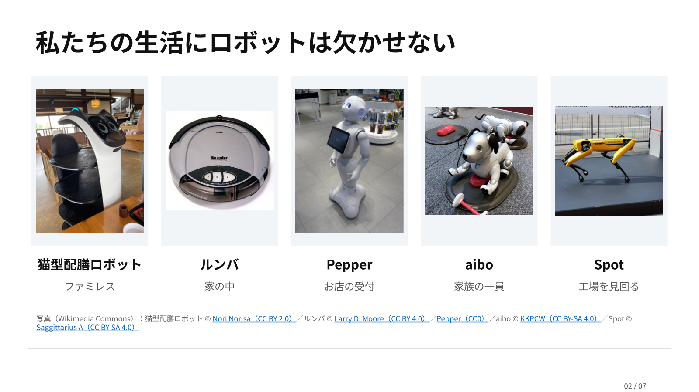
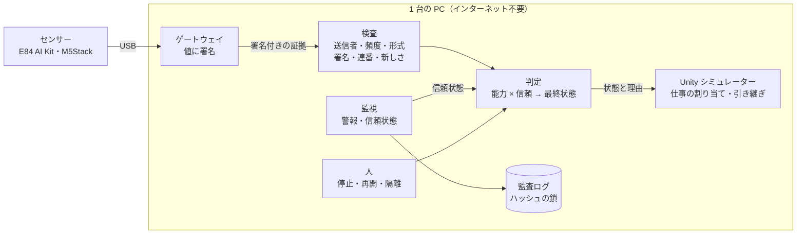
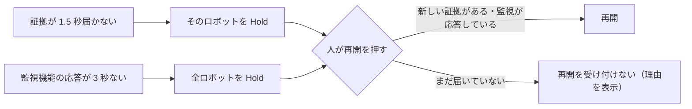
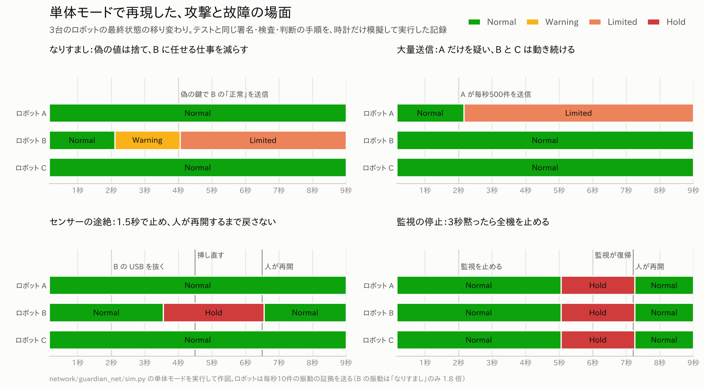
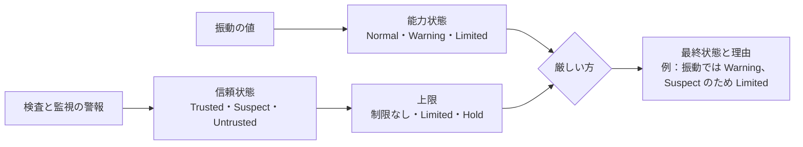

# ロボもり（Physical AI Guardian）

[](docs/images/hero.png)

<!-- チーム名・メンバー・受賞は決まりしだい記入 -->

> **不調なロボットにも、できる仕事を。乗っ取られかけても、止めて守る。**

<div align="center">


[](https://skillicons.dev)

</div>

## 目次

- [リポジトリ構成](#リポジトリ構成)
- [段階的なコード構成](#段階的なコード構成)
- [動画リンク](#動画リンク)
- [製品概要](#製品概要)
  - [特長](#特長)
  - [解決出来ること](#解決出来ること)
  - [今後の展望](#今後の展望)
- [開発技術](#開発技術)
  - [活用した技術](#活用した技術)
  - [独自技術](#独自技術)

## リポジトリ構成

開発環境・起動手順・操作方法は [docs/SETUP.md](docs/SETUP.md)、3D 素材の作り方は [Assets/Art/Restaurant/README.md](Assets/Art/Restaurant/README.md) にまとめています。

| ディレクトリ | 内容 |
|---|---|
| [`Assets/Scripts/`](Assets/Scripts/) | Unity の 3D 配膳シミュレーター。仕事の可否、割り当てと引き継ぎ、皿と交通の管理、操作パネル |
| [`Assets/Editor/`](Assets/Editor/) | シーンの組み立て、3D 素材の取り込み、人物配置の検査を行う Unity エディターの機能 |
| [`Assets/Art/Restaurant/`](Assets/Art/Restaurant/README.md) | Blender の Python スクリプトで自作した家具・人物・料理（21 モデル） |
| [`docs/`](docs/) | 開発環境、実機の組み立て、センサーの候補、審査基準のまとめ、図 |
| [`scripts/`](scripts/) | 購入したロボットの外観（Nekobot）をローカルで取り込むスクリプト |

このリポジトリに収録されているのは Unity シミュレーターのコードと関連素材・資料です。証拠と信頼の中核（署名・検査・判定・監視・監査ログ）は別管理で、本リポジトリには未収録です。「製品説明」の構成図にある検査・判定・監視や Unity との接続、「特長」の 2〜4、「独自技術」の 3〜6 は、その別管理の中核に関する説明です。

## 段階的なコード構成

配布・レビュー時に機能の導入順を追えるよう、次の 6 つのブランチを用意しています。各ブランチは前の段階を含む累積スナップショットです。

| ブランチ | 追加する主な内容 |
|---|---|
| `stage/01-base` | Unity のプロジェクト設定（`Packages/`、`ProjectSettings/` など） |
| `stage/02-restaurant` | レストランの 3D モデル、Prefab、マテリアルと生成ソース |
| `stage/03-runtime` | ロボット、配膳タスク、能力判定、皿・交通・予備機の制御（`Assets/Scripts/`） |
| `stage/04-editor` | シーン生成、素材取込、検証に使う Unity Editor ツール |
| `stage/05-tools` | 任意のローカルモデルを取り込むスクリプトと説明 |
| `stage/06-docs` | README、セットアップ手順、関連資料・図・発表素材 |

この区分は**コードの段階的な導入と検証の順序**を示し、各機能を最初に開発した日時を示すものではありません。各段階のPRでは、変更差分、移植元、実施した検証結果を記録します。CIのワークフローや実機テストの実行環境は、公開先リポジトリの構成に合わせて別途設定します。

## 動画リンク

- デモ動画：公開用リンクは未登録です。準備ができ次第追加します。
- 発表スライド（Hack Day の 90 秒ピッチ）：[ロボもり｜Hack Day 発表スライド](https://docs.google.com/presentation/d/1WQIn4H3_ua5t65tx0b36FbvmO08A6MnyDJwDx9BLvwA/edit?usp=sharing)
- 補足資料（背景・事業・市場と売上の見込み）：[ロボもり｜補足資料](https://docs.google.com/presentation/d/1Fd_nJmBFcWzg-3xrGk1wrq9fqDtnbcEbSC7ygMG9M_Q/edit?usp=sharing)。文章でまとめたものは [docs/BUSINESS.md](docs/BUSINESS.md)
- スライドは Google スライドのリンクで共有しています。閲覧のみで、ダウンロード・印刷・コピーはできません。

## 製品概要

ロボット × 世話（ケア）。不調や乗っ取りからロボットを守りながら、そのロボットにできる仕事を任せ続ける技術です。

### 背景(製品開発のきっかけ、課題等）

ロボットは、もう私たちの生活に欠かせません。ファミレスでは猫型の配膳ロボットが料理を運び、家の中ではルンバが掃除をし、お店の受付では Pepper が案内をし、aibo は家族の一員になり、工場では Spot が見回りをしています。



<sub>写真（Wikimedia Commons、トリミングして掲載）：猫型配膳ロボット © [Nori Norisa](https://commons.wikimedia.org/wiki/File:%E7%8C%AB%E3%81%A1%E3%82%83%E3%82%93%E3%81%8C%E9%85%8D%E8%86%B3%E3%81%97%E3%81%A6%E3%81%8F%E3%82%8C%E3%81%BE%E3%81%99_(53163213643).jpg)（[CC BY 2.0](https://creativecommons.org/licenses/by/2.0/)）／ルンバ © [Larry D. Moore](https://commons.wikimedia.org/wiki/File:Roomba_original.jpg)（[CC BY 4.0](https://creativecommons.org/licenses/by/4.0/)）／[Pepper](https://commons.wikimedia.org/wiki/File:SoftBank_pepper.JPG)（[CC0](https://creativecommons.org/publicdomain/zero/1.0/)）／aibo © [KKPCW](https://commons.wikimedia.org/wiki/File:Aibo_ERS-1000_-_2.jpg)（[CC BY-SA 4.0](https://creativecommons.org/licenses/by-sa/4.0/)）／Spot © [Saggittarius A](https://commons.wikimedia.org/wiki/File:Boston_Dynamics_Spot_in_Milan.jpg)（[CC BY-SA 4.0](https://creativecommons.org/licenses/by-sa/4.0/)）</sub>

**そんな環境で、私が本製品を作ろうと思ったきっかけは、SF 作品です。**

『Detroit: Become Human』という作品をご存じでしょうか。私は、この作品や『PSYCHO-PASS サイコパス』、『ドラえもん』のような、人と AI・ロボットがいっしょに暮らす SF 作品が大好きです。こうした作品でよく描かれるのが、体を持った AI、つまり AI ロボットの暴走です。

現実でも、アメリカや中国を中心に、ロボットにできることは年々増えています。一方で、ロボットを止める技術はそれほど進んでいない、というのが私の実感です。ロボットの導入は、来年あたりからさらに進むと考えています。そのとき、ロボットを止める手段がネットワークの先にある別のシステム頼みのままだと、その通信や仕組みが止まったときにロボットを止められず、大きな事故につながるおそれがあります。

『Detroit: Become Human』のアンドロイドは、こめかみのリングの色（青・黄・赤）で状態がわかります。ロボットも同じように、状態を色で示し、何が起きているかを自分の言葉で説明できれば、センサーの故障のように外からはわかりにくかった異常でも、専門家でなくても状況をつかめます。止めるかどうかを、誰でも判断できるようになる。これが、ロボもりの出発点です。

**大事なのは、誰でも「わかる」ことです。**

ロボットが今どんな状態なのかを、いつでも、誰でも、ロボットの知識がなくても理解できること。私はこれがいちばん大事だと考えています。知識のある人にしかわからない仕組みでは、いざ止めなければならないときに、その場にいる人が止められません。力の強いロボットほど、周りの人が今の状態をわかることが、安全につながります。

だからロボもりは、ロボットに今の状態と理由を説明させ、人が理解したうえで、自分で考えて判断できるようにします。地動説を追い求めた人たちを描いた『チ。 ―地球の運動について―』のように、私たちが焦点を当てているのは「知」、つまり人が自分で考えることです。

**もし、ロボットが人を攻撃したら？**

ロボットは、力も速さも増しています。Unitree の人型ロボット H2-X は、車を凹ませるほどのパワーとスピードを持ち、警護用として、1 回の充電で約 8 時間動きます[^h2x]。

もし、これが乗っ取られたら、最悪こうなります。車を凹ませる力が他人に操られれば、人に向かう凶器になります。しかも、乗っ取ったロボットに「正常です」と偽らせれば、誰も気づけません。


かといって、正確な状況がわからないまま、疑うたびにロボットを止めていたら、キリがありません。人手の足りない現場は回らなくなります。工場で動くロボットの数や、止まったときの損失などの背景は、[事業の背景と展開](docs/BUSINESS.md) にまとめました。

**たとえば、こんな瞬間です。**

金曜の夜 7 時、満席のファミレス。ホールを回すのはアルバイトの店員 2 人と、配膳ロボット 3 台です。そのうちの 1 台が、走るたびに小さく揺れるようになりました。トレイには熱いスープ。ロボットの画面は「正常」のままです。店員は迷います。「止めたら料理が出せなくなる。でも、このまま運ばせて、お客さんにこぼしたら……」。店には、ロボットに詳しい人はいません。

**目指すのは、こんな状態です。**

ロボットに詳しくない店員でも、ロボットの今の状態がひと目でわかり、「スープだけほかのロボットに回して、お皿の片付けは続けてもらおう」と、その場で決められている状態です。

**今の仕組みでは、この場面を埋められません。**

今のロボットの見守りは、多くの場合、ロボット自身の報告がもとになっています。報告が「正常」なら、揺れに気づくきっかけがありません。気づいても、選べるのは止めるか動かすかの二択になりがちで、「この仕事だけ外す」という判断は、詳しい人がいないとできません。

だから、ロボット自身の報告をうのみにせず、ロボットを外から理解し、制御する仕組みが必要です。

**ロボもりは、振動や状態をロボットの外で確かめ、危ない仕事だけを外してほかの仕事は続け、値がおかしければ止めて、再開は人が決めます。不調なロボットにも、乗っ取られかけたロボットにも、できる仕事だけを任せ続けるためのプロダクトです。**

**このハッカソンで確かめたいこと**

ロボットの状態を、知識のない人にもわかる形で伝え、「止める・続ける・この仕事だけ外す」をその場で決められるか。動くもので示し、現場を知る人と議論して、配膳から工場へ広げられるかを確かめます。

### 製品説明（具体的な製品の説明）

ロボもりは、複数のロボットが働く現場で、各ロボットの状態に合わせて「その機体に任せてよい仕事」を決め、任せられなくなった仕事を別の機体へ引き継ぐ運用システムです。判断に使う値は 1 通ずつ確かめ、確かめられないときは止めます。止める・再開する・隔離するといった重要な判断は人が行い、その理由は画面と記録に残ります。

デモは Unity の 3D 配膳シミュレーターです。レストランで 3 台（予備を含めると 5 台）のロボットが、スープ・料理・空いた皿の回収を分担します。


<!-- 公開用のデモ映像・画像が準備できた場合は実際の画面に差し替える -->



| 部品 | 役割 | 状況 |
|---|---|---|
| Unity シミュレーター | 店内・ロボット・人の 3D 表示、物理による移動、仕事の割り当てと引き継ぎ、操作パネル | 本リポジトリに実装あり（模擬入力によるデモ） |
| 検査・判定（guardian-core） | 届いた値を確かめ、能力状態と信頼状態から最終状態と理由を決める | 別管理の実装。本リポジトリには未収録（単体モードの説明あり） |
| 監視（monitor） | メッセージの検査、警報、信頼状態の管理 | 別管理の実装。本リポジトリには未収録（単体モードの説明あり） |
| センサー・ゲートウェイ | 実機の振動・音を測定して署名付きの証拠を送信する構想 | 接続・検証予定。本リポジトリでは実機通信を確認できない |
| Unity との接続 | 中核の判断結果を Unity 側の動作に反映する構想 | 別管理の動作確認用実装はあるが、本リポジトリには未収録 |
| 中継（MQTT）・警報画面 | 部品間の通信、オペレーター向け画面 | 統合予定。本リポジトリには未収録 |

デモで見せる場面は次の 5 つです。

| 場面 | 起きること |
|---|---|
| 振動が上がった機体から、スープを外す | ロボット B が Warning になると、スープは Normal のロボット A へ移り、B は料理と空いた皿の回収を続ける |
| 運んでいる途中で不調になる | 料理を載せたまま任せられなくなったら、元の受け渡し場所へ戻してから別の機体へ引き継ぐ。皿の ID と持ち主で、どの皿がどこにあるかを見失わない |
| 配膳のついでに空いた皿を回収 | 配膳先に食べ終わった皿があれば、同じ訪問で回収する。トレイは最大 4 枚 |
| 予備機の出動と退役 | 稼働 3 台＋予備 2 台の構成で、予備機を出し、不調の機体を退役させる。退役する機体は新しい仕事を受けず、積んだ物を返してから戻る |
| 止める判断は人が行う | STOP を押すと、状態の色とは別に停止する。再開は人の操作だけ |

デモ動画は想定動作です。振動の値の上がり方と注文の入り方は決めた筋書きで入れていますが、どのロボットにどの仕事を任せるか、誰が引き継ぐかは、シミュレーターの判定をそのまま映しています。

### 特長


1 は本リポジトリの Unity シミュレーターで確認できます。2〜4 は別管理の証拠と信頼の中核に関する説明です。本リポジトリ単体ではその中核や実機との接続を実行できません。

#### 1. 「止めるか、動かすか」から「どの仕事なら任せられるか」へ

> [!IMPORTANT]
> 振動から能力の段階を決め、仕事ごとに任せる・任せないを切り替えます。止めずに、できる仕事を続けます。

| 状態 | スープ | 料理 | 空いた皿の回収 |
|---|---|---|---|
| Normal | 任せる | 任せる | 任せる |
| Warning | 任せない | 任せる | 任せる |
| Limited | 任せない | 任せない | 任せる |
| Hold・停止中 | 動かない | 動かない | 動かない |

状態が変わると、許されなくなった仕事の割り当てを取り消し、条件を満たす別の機体に割り当て直します。各ロボットの頭上には 3 色のランプがあり、ウルトラマンのカラータイマーのように、今の状態をまわりに知らせます。

実機の値は、起動時に測った基準（ベースライン）との比で判定します。値がちらついて状態が行き来しないよう、1.5 倍以上が 2 秒続いたら Warning、1.3 倍未満が 5 秒続いたら Normal に戻す、というように上げる条件と下げる条件に差を付けています。

#### 2. 偽の「正常」を見抜き、疑わしい機体に任せる仕事を減らす

> [!IMPORTANT]
> 届いた値を 1 通ずつ確かめ、確かめられない値は判断に使いません。疑わしいロボットには、任せる仕事に上限をかけます。

すべての値は送信者の鍵（Ed25519）で署名されています。受け取った側は、送信者・送る頻度・形式・署名・連番・時刻の新しさを確かめてから使います。

| 信頼状態 | なる条件 | 任せる仕事の上限 |
|---|---|---|
| Trusted | 通常。疑わしい状態のあと 30 秒警報がなければ戻る | 制限なし |
| Suspect | なりすまし、送信頻度の超過、形式の不正が続く、センサー間の食い違い | Limited（空いた皿の回収だけ） |
| Untrusted | 権限外の送信、ありえない連番の飛びなど、鍵が悪用された疑い | Hold（仕事なし。戻すのは人だけ） |

最終状態は、振動から決めた能力状態と、信頼状態による上限の厳しい方です。偽の鍵で「正常」と送っても、その値は捨てられ、その機体の状態はむしろ厳しくなります。**攻撃者にできる最悪のことを、「その機体に任せる仕事を減らす」ことに抑えます。**

#### 3. 黙ったら止まる。インターネットが切れても動く

> [!IMPORTANT]
> 「異常の知らせが来たら止める」のではなく、「正常の知らせが来なくなったら止める」形にしています。外部のサービスに頼らず、1 台の PC の中で完結します。



センサーの線が抜けても、ゲートウェイが固まっても、監視機能が止められても、ロボットは安全側に止まります。時刻は PC の時計だけを基準にし、鍵の一覧は親鍵で署名して USB で配れるようにしているので、クラウドや時刻サーバーがなくても同じように動きます。



上の図は、テストと同じ手順を単体モードで実行した記録です。なりすましを受けたロボット B は Limited に下がり、大量送信をしたロボット A だけが疑われ、センサーが抜けたり監視が止まったりしたときは Hold になって、人が再開するまで戻りません。

#### 4. 決めるのは人、理由は消えない記録に

> [!IMPORTANT]
> 止める・再開する・隔離するのは人です。判断の理由と人の操作は、書き換えを検出できる記録に残ります。

- 人の操作には理由の入力が必要です。証拠がまだ届いていないうちは、再開の操作も受け付けません。
- 警報、信頼状態の変化、人の操作は、前の記録のハッシュをつないだ鎖として残し、1 件ずつ署名します。1 行でも書き換えると、どこが書き換えられたかがわかります。
- AI（LLM）は使うとしても警報の要約だけで、操作の権限は渡しません。AI が動かなくても、判断と警報は変わりません。

### 解決出来ること

- 不調なロボットを止めずに、できる仕事で使い続けられます。現場の仕事が止まりにくくなります。
- 偽の値・古い値・再送された値で判断しないので、故障を隠す攻撃や、健全な機体を止める攻撃の影響を、その機体の仕事を減らす範囲に抑えられます。
- ネットワークが外と切れていても、同じ判断と記録が続きます。
- 判断の理由が残るので、設備保全の担当者が「どの機体の、どの値が、なぜ問題だったか」を後から確かめられます。

### 今後の展望

- **実機センサーとの接続**
  - 実機で振動を測り、署名して送り、Unity と警報画面につなぎます。
- **実機での検証**
  - 実際のロボットとセンサーで、判断の確かさと、運用での効果を確かめます。
- **工場・物流への展開**
  - 配膳で示した仕組みを、工場や物流で働くロボットへ広げます。今あるロボットの管理の仕組みと一緒に使える形を目指します。

### 注力したこと（こだわり等）

- **運んでいる物を見失わない引き継ぎ**
  - 仕事・皿・ロボットにそれぞれ ID を付け、誰がどの皿を持っているかと、どの仕事が誰に割り当てられているかを別々に管理しています。積んだまま担当を外れた場合は、元の受け渡し場所へ戻して皿の持ち主を戻してから、次の機体に割り当てます。仮想の荷物が機体から機体へ瞬間移動することはありません。
- **物理で動く店内**
  - ロボットは Rigidbody による物理で動きます。通路の中央は 1 台ずつしか通れない単線として予約制にし、厨房の受け渡し場所も予約してから入ります。待っているロボットには、何を待っているかを画面に表示します。
- **攻撃と故障を、何度でも同じように再現できるテスト**（中核）
  - 中継や Docker がなくても、全部品を 1 つのプロセスでつなぎ、本番と同じ署名・権限・検査・判断を動かせる単体モードを作りました。なりすまし、再送、大量送信、故障の隠蔽、権限外の送信、監視の停止、記録の改ざんの各場面を、61 件のテストで確かめています。会場で中継が動かない場合の予備のデモにもなります。
- **依存は 1 つ、インターネットなしで入れられる**（中核）
  - 証拠と信頼の仕組みが使う外部ライブラリは `cryptography` だけです。配布ファイルのハッシュまで固定し、事前に保存したファイルから USB で持ち込んで入れられるようにしています。
- **できていないことを、できているように見せない**
  - 画面とログでは、実測の値か模擬の値かを区別します。閾値はデモ用の設定で、実機の安全基準ではないことを明記しています。本リポジトリに含む機能、別管理の機能、今後の検証項目を分けて説明しています。
- **3D 素材の自作**
  - 家具・人物・料理の 21 モデルを、Blender の Python スクリプトで自作しました。ダウンロードした素材や生成サービスは使っていません。

## 開発技術

### 活用した技術

**構成：Unity の 3D シミュレーターで仕事を割り当て、Python の中核で証拠を確かめ、署名と権限表で守る**

| 技術 | ロボもりでの役割 |
|---|---|
|  | 店内・ロボット・人の 3D 表示、物理による移動、操作パネル、録画 |
|  | 仕事の可否、割り当てと引き継ぎ、皿と交通の管理、人の操作の受け付け |
|  | 証拠の検査、状態の判断、監視、監査ログ、単体モード |
|  | ロボット・各部品の署名、鍵の一覧と監査ログの署名 |
|  | 監査ログの改ざん検出 |
|  | 証拠と信頼の中核をコンテナで動かす。PC に Python を入れず、書き込み禁止・権限なしで実行し、Unity を止めると自動で削除 |
|  | 部品間の通信に利用を検討中（本リポジトリ未収録） |
|  | 家具・人物・料理の 3D モデルの自作 |
|  | 受け入れ基準をそのままテストとして残す |

Python・Ed25519・SHA-256・Docker・pytest は、別管理の証拠と信頼の中核に関する技術です（本リポジトリには未収録）。MQTT は通信の統合に利用を検討しています。


上の図は発表資料のもので、Unity シミュレーターの中の流れです。Unity シミュレーターが状態と人の指示を判定・配車エンジンに渡し、エンジンが仕事の可否と理由を返します。判断の理由は記録され、履歴として画面に表示されます。点線の「実機接続（設計中）」は本リポジトリでは未実装です。人の判断履歴（最大512件）と自動検査（統合75項目）は別ブランチの内容で、ここに収録するシミュレーターは画面に直近12件の作業ログを表示します。

#### API・データ

**外部の API とクラウドは使っていません。** インターネットが切れても同じように動くことを優先しました。

- 振動の値（ベースライン比）
  - 起動時に測った基準との比として送ります。シミュレーターでは模擬の値（0〜1）で動かします。
- 3D 素材
  - 家具・人物・料理は自作です（[`Assets/Art/Restaurant/`](Assets/Art/Restaurant/README.md)）。
  - ロボットの外観に使う Nekobot は購入した素材で、ライセンスの都合でリポジトリには含めません。なくても、自作の代替の形で動きます。

#### フレームワーク・ライブラリ・モジュール

**シミュレーター：Unity による 3D 表示・物理移動・操作パネル**

- Unity 6000.3.12f1（Unity 6.3 LTS）、Built-in Render Pipeline
- Rigidbody（物理による移動）、IMGUI（操作パネル）、TextMesh（ロボットの頭上の表示）

**判定と配車：C# で書いた仕事の可否と割り当て（1,488 行）**

- [`GuardianCapabilityPolicy.cs`](Assets/Scripts/GuardianCapabilityPolicy.cs)：状態ごとの仕事の可否
- [`GuardianSimulator.cs`](Assets/Scripts/GuardianSimulator.cs)：割り当て、取り消しと再割り当て、理由の記録
- [`GuardianFleetOperator.cs`](Assets/Scripts/GuardianFleetOperator.cs)：停止と復帰、予備機の出動・退役
- [`GuardianDishInventory.cs`](Assets/Scripts/GuardianDishInventory.cs)：皿の ID・持ち主・予約、トレイの枚数
- [`GuardianTrafficController.cs`](Assets/Scripts/GuardianTrafficController.cs)：単線の通路と受け渡し場所の予約

**証拠と信頼の中核：Python と Ed25519 による検査・判断・記録（別管理の実装、本リポジトリには未収録）**

- Python 3.10 以上（3.13 で確認）
- [cryptography](https://cryptography.io/) 50.0.1：Ed25519 の署名と検証。外部ライブラリはこれだけ
- 標準ライブラリの `hashlib`（SHA-256）と `json`（署名の対象を 1 通りに決める正規化）
- pytest 9.1.1：テスト
- matplotlib：README の図を作るときだけ使用
- Docker（`python:3.12-alpine` を digest で固定、イメージは約 100 MB）：中核のコンテナ。Unity を止めると自動で削除される。テストもコンテナの中で実行できる

**通信・操作画面の連携候補（本リポジトリには未導入）**

- Eclipse Mosquitto（MQTT、TLS、クライアント証明書、権限表）
- pyserial（実機からのシリアル読み取り）、FastAPI（警報画面）

**3D 素材**

- Blender 5.1 の Python スクリプト：家具・人物・料理の形とマテリアルを生成

#### デバイス

実機との接続は今後の検証対象です。組み立て方とセンサーの候補は、[実機の組み立てガイド](docs/HARDWARE_ASSEMBLY.md)と[センサーの候補と精度](docs/REAL_SENSOR_OPTIONS.md)にまとめています。本リポジトリのデモでは模擬入力を使用します。

- Infineon PSOC Edge E84 AI Kit
  - IMU（BMI270）、MEMS マイク、60 GHz レーダーを搭載。振動と異常音を測ります。
- M5Stack（StickS3 / CoreS3）
  - IMU（BMI270）を搭載。小型の振動センサーとして機体に取り付けます。
- Infineon XENSIV MEMS マイク（AudioHub Nano）
  - 駆動部の音を PC に取り込みます。
- 試験台
  - ファンの羽根におもりを付け、振動を変えます。
- PC
  - メモリ 16 GB のノート PC で、すべての部品を動かします。

### 独自技術

#### 仕事ごとの可否と、値の確かさを、1 つの最終状態にまとめる

**ロボもりの中心は、「仕事ごとに任せる」判断と、「その判断に使う値を信じてよいか」の判断を、1 つの最終状態にまとめることです。**

1・2 は本リポジトリに収録された Unity シミュレーター、3〜6 は別管理の証拠と信頼の中核に関する説明です。本リポジトリには 3〜6 の実装は含まれていません。

##### 1. 仕事ごとの可否と、ちらつかない状態の切り替え

**能力の段階を仕事ごとの許可に変換し、状態が変わったら許されない仕事だけを取り消します。**

状態と仕事の対応は 1 つの表（[`GuardianCapabilityPolicy.cs`](Assets/Scripts/GuardianCapabilityPolicy.cs)）で決めています。状態が変わると、許されなくなった仕事だけを取り消して、条件を満たす別の機体に割り当て直します。許されている仕事はそのまま続けるので、Warning になったロボットは料理と回収を止めません。実機の値は、中核で上げる条件と下げる条件に差を付けて判定し、値の小さな揺れで状態が行き来しないようにしています。

##### 2. 運んでいる物を見失わない引き継ぎ

**仕事・皿・ロボットの ID を分けて管理し、引き継ぎの途中でも、どの皿がどこにあるかを常に 1 か所に決めます。**

皿の持ち主（厨房・ロボット・テーブル・回収台）と予約を [`GuardianDishInventory.cs`](Assets/Scripts/GuardianDishInventory.cs) で管理し、トレイは最大 4 枚に制限しています。積んだまま担当を外れたロボットは、元の受け渡し場所まで物理的に運んで持ち主を戻し、そこから次のロボットが受け取ります。

##### 3. 値の「出所・新しさ・順番」を、1 通ずつ確かめる

**すべての値を同じ形の封筒に入れて署名し、受け取った側は軽い検査から順に確かめます。**

```json
{
  "v": 1, "src": "robot-b", "kind": "evidence", "seq": 812, "boot": "5f1c09aa",
  "t_acq": 1793000000123, "t_sent": 1793000000130,
  "body": {"metric": "vib_ratio", "unit": "ratio", "value": 1.8, "valid": true,
           "measured": true, "origin": "KIT_PSE84_AI/BMI270"},
  "sig": "Ed25519 署名（sig 以外の全体を正規化した JSON に対して）"
}
```

| 順番 | 検査 | 通らないとき |
|---|---|---|
| 1 | 話題（トピック）から、送ってよい送信者を決める | 未知の話題は破棄 |
| 2 | 送信者ごとの頻度（ロボットは毎秒 50 件まで）。署名の確認より先に行い、大量送信で計算資源を使い切らせない | 超過分を破棄し、その送信者を Suspect |
| 3 | 形式（4 KB 以下、欄の過不足なし、型と範囲、NaN なし） | 破棄。続けば Suspect |
| 4 | 封筒の送信者が、話題から決まる送信者と一致する | 破棄し、Suspect |
| 5 | 鍵の一覧にある公開鍵で、署名が正しい | 破棄し、Suspect |
| 6 | 連番が前回より大きい。再起動は、前より新しい時刻のときだけ認める | 再送として破棄 |
| 7 | 取得時刻が、受け取った PC の時計で 1.5 秒以内、かつ 0.5 秒より未来でない | 古い・未来の値として破棄 |

連番は、送信頻度の上限から「ありえる進み方」を計算しています。正しい署名なのに連番が大きく飛んだ場合は、鍵が盗まれて使われた疑いとして Untrusted にします。飛んだ値は記録しないので、本物のロボットの送信が締め出されることはありません。検査は判定（guardian-core）と監視（monitor）がそれぞれ独立に行い、どちらか一方が乗っ取られても、もう一方の検査は素通りできません。

##### 4. 能力と信頼の、厳しい方で決める

**振動から決めた能力状態に、値をどこまで信じられるかで上限をかけます。**



信頼状態を決めるのは監視（monitor）で、判定（guardian-core）は署名された信頼状態だけを受け取ります。最終状態には理由の文が付き、画面と記録に残ります。

##### 5. 権限表を 1 つにして、中継と単体モードで同じ規則を守る

**誰がどの話題に送れるかを 1 つの表で定め、中継の設定ファイルも単体モードも、同じ表から作ります。**

ロボットが送れるのは、自分の証拠の話題だけです。ロボットが自分に仕事の許可を出そうとしても中継が拒否し、その拒否から監視が警報を出して Untrusted にします。すべての部品を名前で明示し、置き換えの書き方（`%u`）は使いません。

##### 6. 書き換えを検出できる記録

**記録の 1 件ごとに前の記録のハッシュを入れ、さらに署名します。**

途中の 1 行を書き換えても、削除しても、そこから先の鎖が合わなくなります。鎖ごと作り直すには署名の鍵が必要です。最新のハッシュは短いので、画面や M5Stack に出しておけば、外部のサービスなしで末尾の削除にも気付けます。

#### 確認結果

中核の単体モードで、仕様の受け入れ基準を再現しています（`python -m guardian_net.sim`）。

| 場面 | 結果 |
|---|---|
| ロボット B の振動が 1.8 倍になる | 2 秒後に Warning。それより前は Normal のまま |
| B のセンサーの USB を抜く | 1.5 秒後に Hold。挿し直しても Hold のまま、人の再開で Normal |
| 偽の鍵で B を名乗り「正常」の値を送る | 署名不正の警報。B の振動は 1.8 倍のまま（偽の値は使われない）。Suspect で Limited |
| B の正しいメッセージを記録して再送する | 再送の警報。判断は変わらない |
| 乗っ取られた A が毎秒 500 件を 1 秒間送る | A だけが Suspect。B と C は Normal のまま判断が続く |
| B の振動の値だけを少しずつ下げて故障を隠す | 音との食い違いが 3 秒続いた時点で Suspect、Limited |
| A が自分にスープの仕事の許可を出そうとする | 中継が拒否し、A は Untrusted で Hold |
| 監視機能を止める | 3 秒後に全機 Hold。監視が戻るまで再開を受け付けない |
| 監査ログの 1 行目を書き換える | 1 行目の不一致として検出 |

| 処理時間（1 通あたり） | 結果 |
|---|---|
| 署名 | 中央値 0.15 ms、95% 値 0.25 ms |
| 検査（署名の確認を含む） | 中央値 0.23 ms、95% 値 0.36 ms |
| 1 コアで処理できる量 | 毎秒 約 4,000 通（通常は毎秒 30 通程度） |
| 毎秒 500 件の大量送信を 1 秒間 | 判定と監視の両方の処理が 0.09 秒で終わる |

計測はクラウドの 4 コア環境（Python 3.13）で取得した値です。別の PC での処理性能は未測定のため、利用環境で再計測が必要です。測定用コマンド `python -m guardian_net.bench` は別管理の中核システムに属し、本リポジトリには含まれていません。

[^h2x]: Unitree Robotics 公式 X「[Unitree Introducing: H2-X Kung Fu Legend Guardian](https://x.com/UnitreeRobotics/status/2112819774573179175)」。
