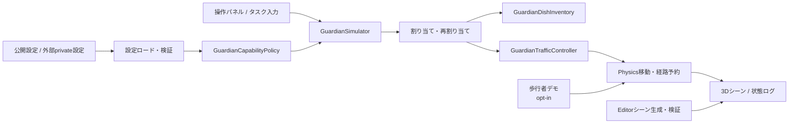

# ロボもり（Guardian Unity Simulator）

> 不調なロボットにも、できる仕事を。

飲食店で稼働する複数の配膳ロボットについて、機体の状態、運んでいる食器、
通路の競合を同時に扱いながら、**止める・仕事を制限する・別の機体へ引き継ぐ**
という判断を可視化するUnityシミュレーターです。


> [!IMPORTANT]
> この公開版は審査と技術検証のためのシミュレーションです。公開サンプル値は
> 実機の安全限界や推奨値ではなく、歩行者デモもUnity内の真値を使います。
> 実センサーや認証済み安全機能を再現するものではありません。

## 目次

- [30秒でわかるロボもり](#30秒でわかるロボもり)
- [解決したい課題](#解決したい課題)
- [公開デモで確認できること](#公開デモで確認できること)
- [仕組み](#仕組み)
- [デモシナリオ](#デモシナリオ)
- [クイックスタート](#クイックスタート)
- [操作方法](#操作方法)
- [実装の見どころ](#実装の見どころ)
- [検証とCI](#検証とci)
- [公開範囲と設定管理](#公開範囲と設定管理)
- [リポジトリ構成](#リポジトリ構成)
- [制約と今後の展開](#制約と今後の展開)

## 30秒でわかるロボもり

一般的な運用では、異常が見つかったロボットを一律に停止すると、残りの機体へ
仕事が集中します。一方、異常を無視して運転を続けると、熱いスープのような
慎重な搬送が必要な仕事まで任せてしまうおそれがあります。

ロボもりは、状態ごとに許可する仕事を分けます。

| 機体状態 | Soup（汁物） | Food（料理） | Return（下げ膳） |
| --- | :---: | :---: | :---: |
| Normal | ✓ | ✓ | ✓ |
| Warning | — | ✓ | ✓ |
| Limited | — | — | ✓ |
| STOP | — | — | — |

たとえばWarningになった機体は汁物を受け取らず、料理と下げ膳には参加できます。
Limitedでは下げ膳だけを担当します。緊急停止中は状態にかかわらず新しい仕事を
受けません。これにより、**安全側へ制限しながら、残された能力を活用する**流れを
画面上で確認できます。

## 解決したい課題

飲食店のピーク時間に3台の配膳ロボットが働いているとします。そのうち1台に
振動の増加が見つかったとき、必要なのは単純な正常・故障の二択だけではありません。

- 何を運んでよいかを、その場で制限できること
- すでに運んでいる物を放置せず、安全な引き継ぎ先まで戻せること
- 同じ狭い通路へ複数台を進入させないこと
- 停止、復帰、再割り当ての判断を人が追跡できること

ロボもりは、この判断をレストランの3Dシーンと操作パネルで説明できる形にします。
機体の稼働率を最大化する最適化製品ではなく、能力制限と再割り当ての考え方を
検証するプロトタイプです。

## 公開デモで確認できること

| 操作・状況 | 画面で確認できる動作 | 主な実装 |
| --- | --- | --- |
| Soup / Food / Returnを追加 | 状態と能力マトリクスに従う割り当て | `GuardianCapabilityPolicy` |
| RobotをWarning / Limitedへ変更 | 不適格な仕事を避けた継続または再割り当て | `GuardianSimulator` |
| 搬送中に状態を悪化 | 積載物を所定位置へ戻してから引き継ぎ | `GuardianDishInventory` |
| 複数台が中央通路へ接近 | 予約と先着順リースによる待機 | `GuardianTrafficController` |
| 緊急停止と復帰 | 新規割り当ての拒否と明示的な復帰 | `GuardianFleetOperator` |
| `-guardianPedestrianDemo` | 横断予測による一時停止と通過後の再開 | `GuardianPedestrianSafety` |
| `-guardianInteractionDemo` | 日本語の状態照会、停止・復帰の確認付き操作 | `GuardianRuleConversation` |

詳しい操作順、期待される表示、審査時の説明上の注意は
[審査デモガイド](docs/JUDGING_GUIDE.md)にまとめています。

## 仕組み

公開版の構成は次のとおりです。外部APIやネットワーク接続を使わず、入力から
割り当て、移動、表示までUnityプロジェクト内で完結します。



判断の中心は、状態から仕事の可否を返す能力ポリシーです。割り当て後は、食器の
所有者と予約を追跡し、通路の利用権を調整しながら移動します。機体状態が途中で
変わった場合も、現在の積載物とタスク段階を見てから引き継ぎます。

## デモシナリオ

### 1. 通常配膳

Soup、Food、Returnのボタンから仕事を追加します。Normalの機体はすべての仕事を
受けられ、空いている機体へ割り当てられます。料理の配膳後に生じる空き皿も
個別ID、所有者、予約状態を持ち、1回に最大4枚まで回収します。

### 2. 状態悪化と能力制限

機体をWarningへ変更すると、新しいSoupタスクの候補から外れます。Limitedへ
変更するとReturnだけを担当します。タスクの途中でその仕事を続けられなくなった
場合は、単にタスク参照を消さず、積載状況に応じて返却または再割り当てへ進みます。

### 3. 緊急停止と復帰

STOPは能力マトリクスより優先され、その機体への新しい割り当てを拒否します。
復帰は別操作として扱うため、状態表示を見ずに自動復帰することはありません。
日本語操作デモでは、停止・復帰の内容を表示したあとに`実行`を入力する二段階操作です。

### 4. 狭い通路の交通制御

分岐、配膳口、返却口をローカルに予約し、中央の狭い通路は先着順のリースとして
扱います。複数台が同時に到着した場合は待機理由を表示し、解放後に次の機体が進みます。

### 5. 予備機と歩行者（任意）

予備機モードでは基本の3台に加えて2台を展開・退役・復旧できます。歩行者デモを
明示的に有効にすると、公開用スタッフモデルが通路を横断し、予測距離と物理障害物
検出によってロボットが減速・停止します。既定では無効のため、通常デモの挙動は
変わりません。

## クイックスタート

### 必要な環境

- Unity Hub
- Unity **6000.3.12f1**
- Git
- Windows / macOS / Linux（環境ごとの描画確認は未完了）

### 起動手順

1. このリポジトリをcloneします。
2. Unity HubからUnity 6000.3.12f1を指定してプロジェクトを開きます。
3. 初回インポートとC#コンパイルの完了を待ち、Consoleにエラーがないことを確認します。
4. Unityメニューの `Guardian > Scene Tools...` を開きます。
5. `Generate Scene` を実行し、`Validate Saved Scene` で公開素材と配置を検証します。
6. 生成された `Assets/Scenes/GuardianRestaurant.unity` を開きます。
7. Playボタンを押します。

初回検証では、非公開モデルや購入素材を追加せずに起動してください。
シーン再生成時は上書き前に確認があり、復元用コピーを
`Library/GuardianSceneBackups`へ保存します。編集中の別シーンとBuild Settingsの
既存項目は保持されます。

## 操作方法

### 画面操作

| 操作 | 用途 |
| --- | --- |
| `Soup T1` / `Food T2` / `Return T3` | テーブル向けの仕事を追加 |
| Robot A/B/Cの状態ボタン | Normal / Warning / Limitedへ変更 |
| `STOP` / 復帰操作 | 緊急停止と明示的な復帰 |
| 予備機のDeploy / Retire / Recover | 予備機を含む構成での運用確認 |
| `Reset` | シナリオを初期状態へ戻す |

### キーボード

| キー | 動作 |
| --- | --- |
| `F7` | PhysicsモードとLegacyStoryモードを切り替え |
| `R` | 現在のシナリオをリセット |

### 任意デモの起動引数

| 引数 | 内容 | 既定値 |
| --- | --- | --- |
| `-guardianPublicSettings` | 公開サンプル設定を明示的に使用 | 無効 |
| `-guardianPedestrianDemo` | 公開用の歩行者横断デモを有効化 | 無効 |
| `-guardianInteractionDemo` | 日本語操作パネルを表示 | 無効 |
| `-guardianSettingsPath <path>` | 外部JSON設定を指定 | 未指定 |

通常起動は既存のデモ設定を維持します。任意機能は明示的に有効にしない限り、
従来のシナリオや検証結果を変更しません。

## 実装の見どころ

### 状態と仕事を分離した能力ポリシー

[GuardianCapabilityPolicy.cs](Assets/Scripts/GuardianCapabilityPolicy.cs)は、機体の状態と
仕事の種類から許可・不許可だけを返します。画面表示や移動処理から判断表を分離し、
割り当て時と継続可否の確認で同じルールを使います。

### 食器を「個数」だけにしない在庫管理

[GuardianDishInventory.cs](Assets/Scripts/GuardianDishInventory.cs)は、各食器のID、所在地、
所有者、予約を追跡します。再割り当て時の二重予約、容量超過、同じ食器の重複を
検出できる構造です。

### 店内全体を止めない交通制御

[GuardianTrafficController.cs](Assets/Scripts/GuardianTrafficController.cs)は、競合箇所だけを
予約します。中央通路では待ち順を保持し、分岐やドックでは近接した機体同士の
利用権を調整します。

### 安全側の任意デモ

[GuardianPedestrianSafety.cs](Assets/Scripts/GuardianPedestrianSafety.cs)は歩行者横断時の
減速・停止・解除を扱います。[GuardianRuleConversation.cs](Assets/Scripts/GuardianRuleConversation.cs)
は許可した日本語コマンドだけを解釈し、状態変更には確認期限と再確認を設けます。
どちらも外部サービスに依存しません。

### 再生成可能な公開シーン

[GuardianSceneSetup.cs](Assets/Editor/GuardianSceneSetup.cs)と
[GuardianSceneTools.cs](Assets/Editor/GuardianSceneTools.cs)で、公開素材からデモシーンを
生成・検証できます。保存済みシーン、Build Settings、生成物の構成を機械的に確認し、
発表環境だけに残った手作業の差を減らします。

## 検証とCI

GitHub Actionsでは、次の検証を行います。

- C#ソース、設定JSON、Unity `.meta` の整合性
- 公開・非公開設定の境界と禁止パス
- 能力マトリクス、歩行者予測、日本語入力に関するソース検査
- Editor統合検証の入口と公開シーン生成コード
- README、審査ガイド、提出チェックリストの相互参照

GitHub ActionsはUnityライセンスを使わないため、CI成功だけでEditorコンパイル、
PlayMode、実際の描画まで成功したとは扱いません。ライセンス済みの
Unity 6000.3.12f1では、Editorを閉じてから次を実行してください。

- Windows: `./scripts/Invoke-GuardianVerification.ps1`
- macOS / Linux: `GUARDIAN_UNITY_PATH=/path/to/Unity ./scripts/verify-guardian-unity.sh`

1回のバッチ起動で、設定境界、能力マトリクス、食器の整合性、歩行者予測、
日本語入力、公開シーン生成を検証します。審査当日の手動確認項目は
[提出チェックリスト](docs/SUBMISSION_CHECKLIST.md)を参照してください。

## 公開範囲と設定管理

### 公開版に含むもの

- Unityシミュレーターと能力制限・割り当ての実装
- 説明用の公開サンプル設定
- 公開素材によるシーン生成と検証ツール
- 審査デモ、静的CI、Unity統合検証の入口

### 公開版に含めないもの

- 実運用の調整値と環境固有設定
- 非公開モデル、アニメーション、音声
- 再配布権を確認できていない素材

実運用設定は `.guardian/guardian-settings.private.json`（Git対象外）へ置くか、
`GUARDIAN_SETTINGS_PATH` / `-guardianSettingsPath <path>` で外部JSONを指定します。
private設定が見つからなくても公開デモは起動でき、private設定を自動生成・自動読込は
しません。入力値は利用前に範囲と相互関係を検証します。

> [!WARNING]
> すでに公開した値は、現在のファイルから削除してもGit履歴や取得済みコピーから
> 自動的には消えません。この分離は今後の実運用値を公開しないための境界であり、
> 過去の公開を取り消す仕組みではありません。

発表時の外観や演出と公開版が異なる可能性、設定の意味、確認済みの境界は
[公開範囲と検証](docs/PUBLIC_SCOPE.md)に記載しています。公開サンプルを実機の
安全限界として説明したり、公開版だけで発表時の全機能を完全再現できると
主張したりしません。

## リポジトリ構成

```text
.
├─ Assets/
│  ├─ Scripts/             # 状態、割り当て、移動、在庫、任意デモ
│  ├─ Editor/              # シーン生成、保存検証、Unity統合検証
│  ├─ StreamingAssets/     # 公開サンプル設定
│  ├─ Art/                 # 自作・配布条件を確認した公開素材
│  └─ Nekobot/             # 任意のローカルモデル取込手順
├─ docs/                   # 公開範囲、審査ガイド、開発履歴
├─ scripts/                # Unityバッチ検証の実行入口
├─ .github/workflows/      # 静的検証と提出資料CI
├─ LICENSE
└─ README.md
```

主な入口は[GuardianSimulator.cs](Assets/Scripts/GuardianSimulator.cs)です。段階的な
PRと各段階の検証内容は[開発履歴](docs/DEVELOPMENT_HISTORY.md)で確認できます。

## 開発技術

- Unity 6000.3.12f1 / C#
- Unity Editor拡張
- Blender / Python（公開素材の制作補助）
- PowerShell / Bash
- GitHub Actions

## 制約と今後の展開

現在の公開版には次の制約があります。

- 歩行者位置、機体状態、振動値はシミュレーター内で生成した値です。
- 実店舗の地図、実機ドライバー、センサー、クラウド監視とは接続していません。
- 公開サンプル値について、実機安全性や性能を保証する試験は行っていません。
- OSごとの描画差と長時間連続運転は、すべての環境で未検証です。
- 発表で用いた可能性のある非公開・権利未確認素材は同梱しません。

今後は、実機やセンサーへ接続する前に、機体ごとの能力記述、ログ形式、故障注入、
長時間シナリオの再現性を拡張し、シミュレーションと実運用の境界を保ったまま
検証項目を増やす予定です。

## 審査・提出資料

- [審査デモガイド](docs/JUDGING_GUIDE.md) — 操作順と期待表示
- [公開範囲と検証](docs/PUBLIC_SCOPE.md) — 公開版と発表構成の境界
- [提出チェックリスト](docs/SUBMISSION_CHECKLIST.md) — 当日の手動確認
- [開発履歴](docs/DEVELOPMENT_HISTORY.md) — 段階的なPR履歴

## ライセンス

コードのライセンスは[LICENSE](LICENSE)を参照してください。

第三者のモデル、音声、画像などについて、本リポジトリのMITライセンスが
再配布許可を与えるものではありません。同梱するNoto Sans JPはMITではなく
SIL Open Font License 1.1の条件で配布されます。出所と条件は
[フォントREADME](Assets/Art/Fonts/README.md)を参照してください。

Nekobotの任意取込手順は[Nekobot README](Assets/Nekobot/README.md)を参照してください。
